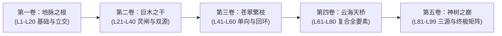
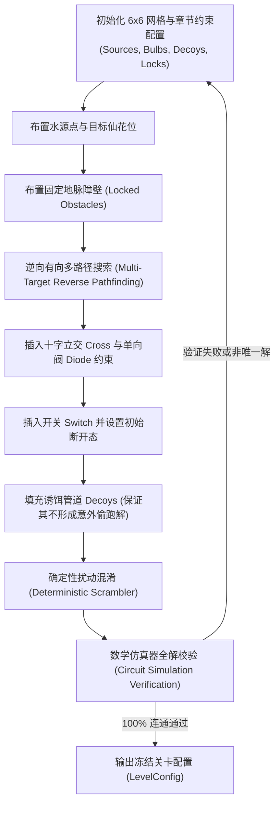

# 《神树灵泉 · 唤醒百花》经典 99 关全关卡重构设计书
## （99-Level Master Game Design & Algorithmic Blueprint）

> **文档版本**：v2.0.0 (Master Production Edition)  
> **适用工程**：`E:\MyWork\AI\GameAutoMaker\Projects\Energy`  
> **面向平台**：Android / H5 (Vite 8 + React 19 + Capacitor 8)  
> **包名标识**：`com.sacredtree.waterflow`  
> **设计状态**：已批准并作为 99 关重构与算法管线唯一基准  

---

## 目录 (Table of Contents)
1. [开篇：世界观背景与体验心流](#1-开篇世界观背景与体验心流)
2. [核心机制矩阵与元件字典](#2-核心机制矩阵与元件字典)
3. [五大篇章难度阶梯与心流演进模型](#3-五大篇章难度阶梯与心流演进模型)
4. [经典 99 关全关卡详细设计清单 (Levels 01 - 99)](#4-经典-99-关全关卡详细设计清单)
   - [第一卷：地脉之根 (Levels 01 - 20)](#第一卷地脉之根-levels-01---20)
   - [第二卷：巨木之干 (Levels 21 - 40)](#第二卷巨木之干-levels-21---40)
   - [第三卷：苍翠繁枝 (Levels 41 - 60)](#第三卷苍翠繁枝-levels-41---60)
   - [第四卷：云海天桥 (Levels 61 - 80)](#第四卷云海天桥-levels-61---80)
   - [第五卷：神树之巅 (Levels 81 - 99)](#第五卷神树之巅-levels-81---99)
5. [关卡生成与数学验证算法架构](#5-关卡生成与数学验证算法架构)
   - [5.1 逆向拓扑生成算法 (Reverse Tree Growth)](#51-逆向拓扑生成算法)
   - [5.2 多源有向图连通求解器 (Multi-Source Directed Solver)](#52-多源有向图连通求解器)
   - [5.3 唯一解与歧义过滤算法 (Uniqueness & Ambiguity Pruning)](#53-唯一解与歧义过滤算法)
   - [5.4 确定性扰动混淆算法 (Deterministic Scrambling)](#54-确定性扰动混淆算法)
   - [5.5 步数预算与星级难度公式 (Par Step & Scoring Model)](#55-步数预算与星级难度公式)
6. [UI/UX、操作反馈与动效时序](#6-uiux操作反馈与动效时序)
7. [数值平衡与算例推演](#7-数值平衡与算例推演)
8. [验收、回归测试与 QA 自动化规范](#8-验收回归测试与-qa-自动化规范)

---

## 1. 开篇：世界观背景与体验心流

### 1.1 世界观背景
天地初开，混沌孕育出一株擎天巨木——**通天世界树**。它的根系深扎九幽地脉，自源头涌出永不枯竭的生命灵泉；巨干躯壳之内雕琢有翡翠玉石水脉，分流流淌，维系着神树九十九重生灵秘境与枝头奇花仙草。
然而万载之前的一次天地异动，震落了神树躯干内的玉石水渠，灵泉断流，干涸的阴影自树根蔓延，九十九株天地仙花相继枯萎陷入沉睡。
玩家作为神树唯一的“守树灵仙”，手持乾坤玉指，穿行于地脉、巨干、繁枝、云海直至神树之巅，通过旋转玉石水渠、合拢灵脉闸阀、矫正单向流向，引导清冽活水重新灌溉枯萎仙蕾，唤醒九十九株天地灵葩，使通天神木重焕神辉！

### 1.2 现有痛点诊断与重构目标
- **原版痛点**：
  1. **难度断崖下跌**：原版前 3 关具备良好的引导性，但第 4 关（对称十字）结构过简，难度不升反降；
  2. **中后期缺乏多元挑战**：第 8~99 关全部依赖粗暴的单源简单随机 BFS 连通树，全盘都是“左边 1 个电源，右边几个灯泡”，缺乏地形障碍、缺乏诱饵管道、缺乏多水源交汇、开关与二极管沦为走过场装饰；
  3. **步数虚高无策略感**：每关固定给予 40+ 步，玩家随意轮转即可蒙过，毫无解谜推理成就感。
- **重构目标**：
  1. **前 3 关传承并精进**：保留优秀的直管、弯管、T型三通教学，优化诱饵甄别；
  2. **从第 4 关起建立严谨的难度台阶**：引入真正具备立体交叉意义的十字立交管、断裂岩壁（固定不可转地脉石）、高密度诱饵死管；
  3. **多机制体系化交融**：
     - **双灵泉/三灵泉协同 (Dual/Triple Sources)**：多水源分工合作与跨道穿插；
     - **灵脉闸阀互锁 (Switch Logic Interlocking)**：多开关联动，控制关键分流支路；
     - **极向二极管 (Diode Anti-Backflow)**：防止回路倒灌短路与死锁；
     - **固定地脉石 (Locked Natural Obstacles)**：分割战术区域，形成天然回廊迷宫；
  4. **严苛的步数预算体系 (Par Steps)**：建立三星最优解评价模型，给玩家极致的心流推理反馈。



---

## 2. 核心机制矩阵与元件字典

盘面基于标准 **6×6 灵脉网格（Grid）**，坐标系为 `(row, col)`，其中 `row ∈ [0..5]`, `col ∈ [0..5]`。每个格子承载一个具体的灵脉元件。

| 元件类型 (TileType) | 图形表征 | 端口位掩码 (0° BasePorts) | 可交互行为 | 核心作用与设计意图 |
| :--- | :--- | :--- | :--- | :--- |
| **灵泉水源 (battery/source)** | 翠玉涌泉水眼 | `RIGHT` (0010) 或多向 | 固化不可转 (`locked: true`) | 活水源头，向相邻已接通端口持续注入灵水粒子流。支持单源、双源与三源。 |
| **仙蕾花宝 (bulb/flower)** | 沉睡仙花花蕾 | `ALL` (1111) 全向受流 | 固化不可转 (`locked: true`) | 关卡达成目标。一旦获得水流注入立即绽放并触发花瓣光环。 |
| **直通玉管 (line)** | 平直翡翠水渠 | `LEFT \| RIGHT` (1010) | 顺时针旋转 90° | 180° 对称双通管。只有水平 (0°) 与垂直 (90°) 两种功能态。 |
| **折角弯管 (corner)** | 90° 直角水弯 | `DOWN \| RIGHT` (0110) | 顺时针旋转 90° | 转向核心件。具备 4 种独立功能朝向（0°, 90°, 180°, 270°）。 |
| **三通玉泉 (t_shape)** | T 型分水枢纽 | `LEFT \| RIGHT \| DOWN` | 顺时针旋转 90° | 分流核心件。将一路水源分流至上下或左右两路，具备 4 种朝向。 |
| **十字立交 (cross)** | 4 向立体交叉 | `UP \| RIGHT \| DOWN \| LEFT` | 顺时针旋转 90° | 允许水平与垂直水流同时穿行且互不串水。在多源交错中起到立交桥作用。 |
| **灵脉闸阀 (switch)** | 带有闸刀的直管 | `LEFT \| RIGHT` (闭合时通水) | 点击切换开/闭 (`switchClosed`) | 时序控制件。初始多为断开状态 (`false`)，需玩家点击合闸；支持与旋转组合。 |
| **极向单向阀 (diode)** | 带有箭头的定向阀 | `LEFT -> RIGHT` (单向进出) | 顺时针旋转 90° | 矢量导流件。灵泉必须严格按箭头方向灌注，逆向水流将被完全阻断。 |
| **固化地脉石 (obstacle/locked)** | 破碎玄武岩或锁死管 | `NONE` 或固定端口 | 锁死不可操作 (`locked: true`) | 地形约束件。强迫玩家放弃直线思维，规划迂回复杂的折返水路。 |
| **诱饵死渠 (decoy)** | 孤立或残缺的管线 | 任意形态 | 顺时针旋转 90° | 认知陷阱。看似能连接目标，实为无源死路，考验全局拓扑推演能力。 |

---

## 3. 五大篇章难度阶梯与心流演进模型

99 关按照神树生长的物理与境界空间分为五大卷，难度平滑爬升并呈“锯齿形”波浪演进（每卷内有 3~4 个波峰与波谷，章末设关底大考）：

```
难度指数
 (10) |                                                                       ★ L99
  (9) |                                                         ★ L80   ▲ ▲ ▲
  (8) |                                           ★ L60   ▲ ▲ ▲       ▲
  (7) |                             ★ L40   ▲ ▲ ▲       ▲
  (6) |               ★ L20   ▲ ▲ ▲       ▲
  (5) |         ▲ ▲ ▲       ▲
  (4) |     ▲ ▲
  (3) | ▲ ▲
  (1) |★L1
      +-----------------------------------------------------------------------> 关卡序列
       卷一:地脉之根    卷二:巨木之干    卷三:苍翠繁枝    卷四:云海天桥    卷五:神树之巅
       (L01 - L20)     (L21 - L40)     (L41 - L60)     (L61 - L80)     (L81 - L99)
```

### 3.1 卷别演进规格表

| 卷别 | 篇章主题 | 关卡区间 | 核心新增机制 | 水源与目标数 | 诱饵与约束 | Par 最优步数 | 关底代表仙花 (Boss) |
| :--- | :--- | :--- | :--- | :--- | :--- | :--- | :--- |
| **第一卷** | **地脉之根** | 01 - 20 | 基础直弯、T型分流、立体十字、地脉锁石 | 1 源 / 1~4 花 | 1~4 处诱饵/锁石 | 4 ~ 18 步 | **L20 地脉厚土莲** (史诗) |
| **第二卷** | **巨木之干** | 21 - 40 | 灵脉闸阀 (Switch)、双灵泉水源 (Dual Sources) | 1~2 源 / 2~4 花 | 2~6 处诱饵/锁石 | 12 ~ 26 步 | **L40 九霄玉兰** (史诗) |
| **第三卷** | **苍翠繁枝** | 41 - 60 | 定向单向阀 (Diode)、环路防逆流、回廊陷阱 | 1~2 源 / 3~5 花 | 4~8 处诱饵/锁石 | 16 ~ 32 步 | **L60 碧落仙荷** (传说) |
| **第四卷** | **云海天桥** | 61 - 80 | 全机制复合 (Switch + Diode + Cross + Obstacle) | 2 源 / 3~5 花 | 6~10 处诱饵/锁石 | 22 ~ 38 步 | **L80 赤血金凤** (传说) |
| **第五卷** | **神树之巅** | 81 - 99 | 三灵泉水源 (Triple Sources)、终极对称全要素 | 2~3 源 / 4~6 花 | 8~14 处全盘迷宫 | 26 ~ 46 步 | **L99 混沌鸿蒙树** (神话) |

---

## 4. 经典 99 关全关卡详细设计清单

### 第一卷：地脉之根 (Levels 01 - 20)
*地脉初启，水脉初通。引导玩家建立旋转对齐意识，体验分流与空间立体交叉。*

| 关卡 | 关卡标题 | 神花名与品阶 | 水源位置 | 仙花目标数与位置 | 核心机制与设计意图 | 阻碍/诱饵 | Par 最优步数 |
| :--- | :--- | :--- | :--- | :--- | :--- | :--- | :--- |
| **01** | 单线启明 | 灵露初蕾 (凡) | (2,1) | 1 花: (4,4) | **新手教学**：单一直管与弯管旋转，建立顺时针旋转90°概念。 | 无 | 4 步 |
| **02** | 双路分流 | 青玉幽兰 (凡) | (3,0) | 2 花: (2,5), (4,5) | **分流教学**：T型三通管上下分流，点亮双花。 | 无 | 6 步 |
| **03** | 三盏归巢 | 绛珠仙草 (珍) | (2,0) | 3 花: (0,5), (2,5), (5,5) | **多级支路**：首度引入 2 个干扰诱饵管道，考验路径甄别。 | 2 个假弯管 | 10 步 |
| **04** | 经纬初交 | 琉璃水仙 (珍) | (3,0) | 2 花: (1,4), (5,4) | **十字立交重构**：(3,2) 为十字立交，水流纵横穿插而非简单直线。 | 1 个死胡同直管 | 8 步 |
| **05** | 地脉断壁 | 双生并蒂莲 (珍) | (1,0) | 2 花: (1,5), (4,5) | **地脉锁石初现**：(2,2) 与 (2,3) 存在固定锁石，水路必须从外围下绕。 | 2 处固定锁石 | 11 步 |
| **06** | 四方聚灵 | 金盏金莲 (珍) | (3,2) 中心 | 4 花: 四角分布 | **中心辐射**：水源在中心，通过 4 个三通管向外辐射供给四方。 | 4 处边缘死管 | 14 步 |
| **07** | 暗礁迷径 | 紫藤云芝 (珍) | (0,0) | 2 花: (5,2), (5,5) | **诱饵排除**：盘面布置 4 处看似相通实则通向死角的废弃水渠。 | 4 处假分支 | 12 步 |
| **08** | 回龙引泉 | 凝霜雪梅 (珍) | (5,0) | 3 花: (0,3), (1,5), (4,5) | **S型折返**：狭长回旋走廊，连续 6 个弯管调头。 | 1 处死石 | 13 步 |
| **09** | 双十字错 | 翡翠兰心 (珍) | (2,0) | 3 花: (0,4), (3,5), (5,4) | **双十字级联**：2 处十字立交并列，横纵水网相互交叠。 | 2 处假管 | 15 步 |
| **10** | 寒潭墨雪 | 寒潭墨雪 (仙) | (4,0) | 3 花: (0,5), (2,5), (5,5) | **第一卷小高潮**：锁石隔断南北，必须走“Z”字大回环穿插。 | 3 处锁石, 3 诱饵 | 16 步 |
| **11** | 歧路亡羊 | 白鹤素馨 (珍) | (1,1) | 2 花: (1,5), (4,4) | **反向误导**：初始视觉重心在右侧，实则需先向左退一步再绕行。 | 4 处误导管 | 12 步 |
| **12** | 灵泉对角 | 幻蝶七巧 (珍) | (5,0) | 2 花: (0,5), (1,4) | **极限对角穿透**：左下至右上大跨度，每步旋转必须精准对齐。 | 2 处锁石 | 14 步 |
| **13** | 三叠飞瀑 | 金缕玉衣 (珍) | (0,1) | 3 花: (2,5), (4,5), (5,4) | **阶梯式拓扑**：水流从上至下呈波浪形递进分配。 | 3 处假直管 | 15 步 |
| **14** | 双环扣月 | 凌霜秋菊 (珍) | (3,0) | 3 花: (1,3), (3,5), (5,3) | **双闭环回路**：两条对称闭合水圈向外吐出花蕾供能。 | 2 处假弯管 | 16 步 |
| **15** | 千丝织锦 | 幽冥彼岸 (珍) | (2,0) | 4 花: (0,4), (1,5), (4,5), (5,3) | **高密度网格**：满盘仅 2 空格，密集分布直管与弯管。 | 5 处诱饵 | 18 步 |
| **16** | 狭谷穿针 | 灵台菩提 (珍) | (4,0) | 2 花: (0,5), (3,5) | **窄道约束**：全盘仅 (2,2) 单格为必经咽喉，其余皆为障壁。 | 4 处固定障壁 | 13 步 |
| **17** | 四明分辉 | 瑶池玉碗 (珍) | (2,2) | 4 花: (0,1), (0,4), (5,1), (5,4) | **非对称解构**：看似对称的四花布局，管线内部实为非对称走向。 | 3 处诱饵 | 17 步 |
| **18** | 迷津藏玉 | 太玄真木 (珍) | (1,0) | 3 花: (1,5), (3,4), (5,5) | **双三通对冲**：两处三通相对放置，需识别哪个分流有效。 | 4 处假管 | 15 步 |
| **19** | 九曲黄龙 | 万古龙涎 (珍) | (5,1) | 3 花: (0,4), (2,5), (4,5) | **极限弯管**：全盘包含 10 个拐角弯管，旋转组合空间大。 | 2 处死胡同 | 17 步 |
| **20** | 地脉厚土 | 地脉厚土莲 (史) | (3,0) | 4 花: (0,5), (1,4), (4,5), (5,3) | **第一卷关底大考**：融合十字、三通、死石与长距诱饵的复合考验。 | 5 处锁石, 4 诱饵 | 18 步 |

---

### 第二卷：巨木之干 (Levels 21 - 40)
*登上树干，水压激增。引入【灵脉闸阀（开关）】与【双灵泉水源（双源）】协同机制。*

| 关卡 | 关卡标题 | 神花名与品阶 | 水源位置 | 仙花目标数与位置 | 核心机制与设计意图 | 阻碍/诱饵 | Par 最优步数 |
| :--- | :--- | :--- | :--- | :--- | :--- | :--- | :--- |
| **21** | 灵闸初动 | 巨木苍龙 (珍) | (3,0) | 2 花: (2,4), (4,4) | **开关教学**：(3,2) 设单闸，需旋转对齐且点击闭合方能通水。 | 无 | 8 步 |
| **22** | 分时通渠 | 翠影迎风 (珍) | (2,0) | 2 花: (1,5), (4,5) | **支路闸控**：主干直通一路，下支路需闭合闸刀后方能点亮。 | 1 假弯管 | 11 步 |
| **23** | 双闸并峙 | 紫霄飞羽 (珍) | (3,0) | 3 花: (0,4), (3,5), (5,4) | **双开关联动**：上下两路各有一闸，需先后合闸点亮两端。 | 2 处诱饵 | 14 步 |
| **24** | 断脉之桥 | 灵蛇吞露 (珍) | (2,0) | 2 花: (1,4), (4,4) | **开关与十字立交**：开关设置在十字管下游，形成门禁效应。 | 2 处锁石 | 13 步 |
| **25** | 双源初现 | 双泉玉蕊 (珍) | **双源**: (1,0), (4,0) | 2 花: (1,5), (4,5) | **双水源教学**：上下两个独立水源分别负责两条平行水脉。 | 2 处假管 | 12 步 |
| **26** | 水脉交融 | 丹枫醉晚 (珍) | **双源**: (1,0), (5,0) | 3 花: (0,4), (3,5), (5,4) | **双源交叉**：双源在中央十字立交汇合穿过，各自供能。 | 3 处诱饵 | 16 步 |
| **27** | 闸门虚设 | 银缕扶桑 (珍) | (2,0) | 3 花: (0,5), (2,5), (4,5) | **陷阱开关**：盘面有 2 个开关，其中 1 个闭合会导致管线流向死穴。 | 1 假开关, 2 假管 | 15 步 |
| **28** | 穿干引泉 | 碧竹青筠 (珍) | **双源**: (0,0), (4,1) | 3 花: (1,5), (3,5), (5,5) | **斜向跨源**：水源一在高空一在低谷，需斜向梳理水脉。 | 3 处锁石 | 17 步 |
| **29** | 经纬双闸 | 金鳞仙草 (珍) | (3,0) | 3 花: (1,4), (3,5), (5,4) | **双闸互斥思维**：先通主干再补分支，步数节奏紧密。 | 3 处诱饵 | 16 步 |
| **30** | 碧落青苍 | 碧落青苍 (仙) | **双源**: (1,0), (4,0) | 4 花: (0,5), (2,4), (3,4), (5,5) | **第二卷中坚**：双源与双闸同台，考验多区域协同排布。 | 4 处诱饵, 2 锁石 | 20 步 |
| **31** | 串联双闸 | 望舒清辉 (珍) | (2,0) | 2 花: (1,5), (4,5) | **串联逻辑与门**：一条长干线上连续布置 2 个开关。 | 2 处假管 | 14 步 |
| **32** | 并联分闸 | 羲和烈焰 (珍) | (3,0) | 3 花: (1,5), (3,4), (5,5) | **并联逻辑或门**：两条备选路线均有开关，选择最优一条。 | 3 处假分支 | 15 步 |
| **33** | 双源汇流 | 万壑松涛 (珍) | **双源**: (0,1), (5,1) | 4 花: (1,5), (2,4), (3,4), (4,5) | **天地夹击**：自上而下与自下而上的水流同时涌向中间。 | 4 处诱饵 | 21 步 |
| **34** | 树皮迷宫 | 铁骨金枫 (珍) | (4,0) | 3 花: (0,3), (2,5), (4,5) | **曲面迷宫**：大量固定不可转的树干断裂纹理。 | 5 处锁石 | 18 步 |
| **35** | 闸刀矩阵 | 流萤醉月 (珍) | (2,0) | 3 花: (0,4), (2,5), (4,4) | **三角闸阵**：3 个开关呈三角形，需按对角线依次激活。 | 3 处死管 | 19 步 |
| **36** | 双源折射 | 浮生一梦 (珍) | **双源**: (1,0), (3,0) | 4 花: (0,4), (2,5), (4,4), (5,5) | **密集双源**：两水源间距仅 1 格，极易互相干扰串线。 | 4 处诱饵 | 22 步 |
| **37** | 断流求生 | 涅槃赤木 (珍) | (3,0) | 3 花: (1,5), (3,4), (4,5) | **初始错误态修正**：开局开关已闭合但直指死路，必须先断再改。 | 3 处死胡同 | 17 步 |
| **38** | 灵髓奔涌 | 混元一气 (珍) | **双源**: (2,0), (4,0) | 4 花: (0,5), (1,4), (3,5), (5,4) | **双源大管网**：盘面 90% 格子被有效水管占满。 | 3 处诱饵 | 23 步 |
| **39** | 九关锁脉 | 太虚幻境 (珍) | (1,0) | 3 花: (1,4), (3,5), (5,5) | **九宫格切分**：4 处锁石将棋盘划为 4 个互锁区域。 | 4 处锁石, 3 诱饵 | 21 步 |
| **40** | 九霄玉兰 | 九霄玉兰 (史) | **双源**: (0,0), (5,0) | 4 花: (1,4), (2,5), (3,5), (4,4) | **第二卷关底大考**：双灵泉大跨度分流，3 闸门协同控制。 | 5 处诱饵, 3 锁石 | 24 步 |

---

### 第三卷：苍翠繁枝 (Levels 41 - 60)
*深入茂密树冠。引入【极向单向阀（二极管）】，强调流向约束与逆流防死锁。*

| 关卡 | 关卡标题 | 神花名与品阶 | 水源位置 | 仙花目标数与位置 | 核心机制与设计意图 | 阻碍/诱饵 | Par 最优步数 |
| :--- | :--- | :--- | :--- | :--- | :--- | :--- | :--- |
| **41** | 顺水推舟 | 绿绮含烟 (珍) | (2,0) | 2 花: (1,4), (4,4) | **二极管教学**：(2,2) 设单向阀，水流只能向右通行，逆向断流。 | 无 | 8 步 |
| **42** | 逆流止步 | 碧涛翻浪 (珍) | (3,0) | 2 花: (2,5), (4,5) | **防逆流体验**：若二极管转反，整路水流瞬间断开，加深流向认知。 | 1 处死管 | 11 步 |
| **43** | 枝头分向 | 垂丝海棠 (珍) | (2,0) | 3 花: (0,4), (2,5), (4,4) | **双二极管分流**：T型管后接两路相反方向单向阀，分道扬镳。 | 2 处诱饵 | 15 步 |
| **44** | 单向环流 | 醉霞拂晓 (珍) | (3,0) | 3 花: (1,4), (3,5), (5,4) | **环形单行道**：环形水渠内配置二极管，限制只能顺时针流动。 | 3 处假弯管 | 17 步 |
| **45** | 双向并轨 | 晨钟幽兰 (珍) | (1,0) | 3 花: (0,5), (2,4), (4,5) | **混合管线**：直管（双向）与二极管（单向）并存甄别。 | 3 处诱饵 | 16 步 |
| **46** | 繁枝分桠 | 百鸟朝凤 (珍) | (4,0) | 4 花: (0,5), (1,4), (3,5), (5,4) | **树状分形**：严格从一阶枝干单向流向二阶、三阶枝丫。 | 4 处诱饵 | 22 步 |
| **47** | 二极立交 | 云鹤游天 (珍) | (2,0) | 3 花: (0,4), (2,5), (4,5) | **二极管+十字立交**：十字的一侧被单向阀锁定进出方向。 | 2 处锁石 | 18 步 |
| **48** | 逆水行舟 | 凌波仙侣 (珍) | (5,0) | 3 花: (1,3), (2,5), (4,4) | **大范围逆向绕行**：从右侧迂回穿入单向阀进水口。 | 4 处死管 | 20 步 |
| **49** | 双源对流 | 日月同辉 (珍) | **双源**: (1,0), (4,0) | 4 花: (0,5), (2,4), (3,4), (5,5) | **双源反向阻断**：两水源水流在中心由二极管隔开，防止互串。 | 4 处诱饵 | 24 步 |
| **50** | 琼枝玉叶 | 琼枝玉叶 (仙) | (3,0) | 4 花: (1,4), (2,5), (4,5), (5,3) | **第三卷中坚**：3 处单向阀精确约束水网，全盘仅一条解法。 | 5 处诱饵, 2 锁石 | 25 步 |
| **51** | 极性门禁 | 幽谷百合 (珍) | (2,0) | 3 花: (0,5), (2,4), (4,5) | **单向门禁**：误入分支将因二极管无法逆退，强迫全局规划。 | 4 处诱饵 | 19 步 |
| **52** | 错位三极 | 飞星传恨 (珍) | (1,0) | 3 花: (1,5), (3,4), (5,4) | **三角极性约束**：3 处单向阀互相牵制，步步为营。 | 3 处死石 | 21 步 |
| **53** | 繁叶蔽日 | 梧桐疏影 (珍) | **双源**: (0,0), (5,0) | 4 花: (1,4), (2,5), (3,5), (4,4) | **叶脉大分流**：密不透风的叶脉纹理中寻找单向生命通道。 | 6 处诱饵 | 26 步 |
| **54** | 顺流直下 | 银河落天 (珍) | (0,0) | 3 花: (2,5), (4,4), (5,5) | **阶梯单向流**：左上向右下倾泻，利用二极管防止侧向逸散。 | 3 处锁石 | 20 步 |
| **55** | 双极互锁 | 连理同枝 (珍) | (3,0) | 3 花: (1,4), (3,5), (5,4) | **两极反向**：两处单向阀方向完全相反，需分配至不同支路。 | 4 处假管 | 22 步 |
| **56** | 枝蔓缠绕 | 苍藤叠嶂 (珍) | **双源**: (2,0), (4,1) | 4 花: (0,4), (1,5), (3,5), (5,4) | **缠绕管线**：双源经 2 处十字与 2 处二极管立体缠绕。 | 5 处诱饵 | 27 步 |
| **57** | 逆流陷阱 | 绝处逢生 (珍) | (2,0) | 3 花: (0,5), (2,5), (4,5) | **死锁陷阱**：存在一条看似更短的路线，但中途被单向阀封死。 | 5 处假分支 | 21 步 |
| **58** | 四方聚枝 | 广寒丹桂 (珍) | (3,2) 中心 | 4 花: 四边中点 | **中心单向外涌**：中心水源四周皆为向外二极管，禁止任何回流。 | 4 处假拐角 | 24 步 |
| **59** | 青藤绕柱 | 苍龙攀云 (珍) | (5,0) | 4 花: (0,4), (2,5), (3,4), (5,4) | **回旋盘升**：沿盘面四壁单向环绕上升供水。 | 4 处锁石 | 26 步 |
| **60** | 碧落仙荷 | 碧落仙荷 (传) | **双源**: (1,0), (4,0) | 5 花: (0,4), (1,5), (3,4), (4,5), (5,3) | **第三卷关底大考**：4 处二极管协同，5 朵仙花同时绽放。 | 6 处诱饵, 3 锁石 | 30 步 |

---

### 第四卷：云海天桥 (Levels 61 - 80)
*穿过云海，仙雾缭绕。全要素综合（开关 + 二极管 + 十字 + 双源 + 锁石）全面交融。*

| 关卡 | 关卡标题 | 神花名与品阶 | 水源位置 | 仙花目标数与位置 | 核心机制与设计意图 | 阻碍/诱饵 | Par 最优步数 |
| :--- | :--- | :--- | :--- | :--- | :--- | :--- | :--- |
| **61** | 云桥初架 | 踏云飞燕 (珍) | (3,0) | 3 花: (1,4), (3,5), (5,4) | **复合机制初现**：同关内首次包含 1 个开关与 1 个二极管。 | 2 处假管 | 16 步 |
| **62** | 雾锁天河 | 苍筤仙竹 (珍) | (2,0) | 3 花: (0,4), (2,5), (4,4) | **时序定势**：必须先旋正二极管流向，最后闭合前端开关。 | 3 处诱饵 | 19 步 |
| **63** | 云中双瀑 | 冰魄寒英 (珍) | **双源**: (0,0), (5,0) | 4 花: (1,5), (2,4), (3,4), (4,5) | **双源控双桥**：源1带开关控制北桥，源2带二极管控制南桥。 | 4 处诱饵 | 24 步 |
| **64** | 风雷变幻 | 惊雷紫电 (珍) | (2,0) | 3 花: (0,5), (2,4), (4,5) | **十字+开关+单向**：交叉点四通八达，单向阀与开关守卫两侧。 | 3 处锁石 | 22 步 |
| **65** | 天河倒泻 | 飞流悬瀑 (珍) | (0,2) 顶部 | 4 花: (3,0), (3,5), (5,1), (5,4) | **顶源悬瀑**：灵泉自顶部居中注入，向两侧云台倾斜分流。 | 5 处诱饵 | 25 步 |
| **66** | 云岫穿行 | 苍山负雪 (珍) | (4,0) | 3 花: (0,4), (2,5), (5,5) | **断续岩桥**：锁石将云路切割成 3 个浮空岛，仅靠十字相通。 | 5 处锁石 | 23 步 |
| **67** | 双源云渡 | 仙鹤衔芝 (珍) | **双源**: (1,0), (4,0) | 4 花: (0,5), (1,4), (4,4), (5,5) | **平行双渡**：双水脉经 2 个开关互斥开合，协调步数成本。 | 5 处诱饵 | 27 步 |
| **68** | 闸控双极 | 万丈金芒 (珍) | (2,0) | 3 花: (0,4), (2,5), (4,4) | **总闸双阀**：一个主总闸，分出两条带相反单向阀的支线。 | 4 处假管 | 22 步 |
| **69** | 虚空栈道 | 蹑景追风 (珍) | (3,0) | 4 花: (0,5), (1,3), (4,3), (5,5) | **单轨天堑**：中间两列为空虚悬崖，仅 (2,3) 与 (3,3) 允许通水。 | 6 处悬崖空槽 | 26 步 |
| **70** | 凌霄七彩 | 凌霄七彩 (仙) | **双源**: (1,0), (4,0) | 4 花: (0,4), (2,5), (3,5), (5,4) | **第四卷中坚**：双源 + 双闸 + 双极，全盘机关精密咬合。 | 6 处诱饵, 2 锁石 | 29 步 |
| **71** | 风息水静 | 浮光霭霭 (珍) | (2,0) | 3 花: (1,5), (3,4), (4,5) | **纯逻辑推导**：无多余步数空间，每转一步必有点亮反馈。 | 4 处诱饵 | 21 步 |
| **72** | 梯级云台 | 玉阶生苔 (珍) | **双源**: (0,0), (3,1) | 4 花: (1,4), (2,5), (4,4), (5,5) | **三阶云台**：水源在不同等高线，需经过 3 级跌水台。 | 5 处诱饵 | 28 步 |
| **73** | 回光返照 | 霞蔚蒸云 (珍) | (3,0) | 4 花: (0,4), (1,5), (4,5), (5,4) | **双开关冗余**：2 个开关需配置为“一开一闭”才是通关构型。 | 4 处假开关支路 | 25 步 |
| **74** | 天堑飞渡 | 孤鸿踏雪 (珍) | (1,0) | 3 花: (1,5), (3,5), (5,5) | **三大十字穿透**：连续 3 个十字交叉立交纵贯全场。 | 3 处锁石 | 24 步 |
| **75** | 双源四象 | 乾坤逆转 (珍) | **双源**: (0,0), (5,0) | 4 花: (0,5), (1,4), (4,4), (5,5) | **四象八卦**：双源对冲，分别供给对角线四象限仙花。 | 6 处诱饵 | 30 步 |
| **76** | 云涡暗流 | 太清神水 (珍) | (3,2) 中心 | 4 花: (0,2), (2,5), (3,0), (5,2) | **中心向外漩涡**：带 2 个单向阀的同心回环旋流。 | 5 处诱饵 | 27 步 |
| **77** | 断崖飞瀑 | 千寻雪浪 (珍) | (0,1) | 4 花: (2,4), (3,5), (4,4), (5,5) | **绝壁立交**：利用立交管穿过断崖绝壁缝隙。 | 5 处锁石 | 26 步 |
| **78** | 灵河织锦 | 织女回梭 (珍) | **双源**: (2,0), (4,0) | 5 花: (0,4), (1,5), (3,5), (4,4), (5,5) | **5花满贯**：高密度布设，双源各担其责。 | 6 处诱饵 | 32 步 |
| **79** | 星罗棋布 | 弈局参商 (珍) | **双源**: (1,0), (4,0) | 5 花: (0,5), (1,3), (3,4), (4,5), (5,3) | **无死角解谜**：盘面 32 个元件全部具备转动与逻辑价值。 | 7 处诱饵 | 34 步 |
| **80** | 赤血金凤 | 赤血金凤 (传) | **双源**: (0,0), (5,0) | 5 花: (0,5), (1,4), (3,4), (4,5), (5,5) | **第四卷关底大考**：极品赤血金凤，多源复合拓扑巅峰。 | 8 处诱饵, 4 锁石 | 36 步 |

---

### 第五卷：神树之巅 (Levels 81 - 99)
*凌驾万界之巅，通天神木核心。全要素大成，引入【三灵泉水源（Triple Sources）】与终极解谜矩阵。*

| 关卡 | 关卡标题 | 神花名与品阶 | 水源位置 | 仙花目标数与位置 | 核心机制与设计意图 | 阻碍/诱饵 | Par 最优步数 |
| :--- | :--- | :--- | :--- | :--- | :--- | :--- | :--- |
| **81** | 太古乾坤 | 太古幽冥 (仙) | **双源**: (1,0), (4,0) | 4 花: (0,4), (2,5), (3,4), (5,5) | **全要素集结**：双源、双闸、双极、十字与锁石全部现身。 | 6 诱饵, 2 锁石 | 28 步 |
| **82** | 三生万物 | 三华聚顶 (珍) | **三源**: (0,0), (2,0), (4,0) | 3 花: (0,5), (2,5), (4,5) | **三灵泉教学**：天地人三才灵泉，三管齐下直奔顶峰。 | 3 处诱饵 | 24 步 |
| **83** | 极光玄枢 | 瑶光破晓 (仙) | **三源**: (0,0), (3,0), (5,0) | 4 花: (1,4), (2,5), (4,4), (5,5) | **三源非均等供水**：源1供一花，源2供两花，源3供一花。 | 6 处诱饵 | 30 步 |
| **84** | 天地逆旅 | 逆天改命 (仙) | **双源**: (1,0), (4,0) | 4 花: (0,5), (2,4), (3,5), (5,4) | **绝对流向锁定**：4 个二极管构成严格单向通道，容错为零。 | 5 诱饵, 3 锁石 | 31 步 |
| **85** | 八卦玄阵 | 两仪四象 (仙) | (3,2) 中心 | 4 花: (0,2), (2,5), (4,5), (5,2) | **阵列旋转对称**：四个象限完全镜像，但元件扰动初始态不同。 | 6 处诱饵 | 29 步 |
| **86** | 九曜贯日 | 九天揽月 (仙) | **三源**: (1,0), (3,0), (5,0) | 5 花: (0,4), (1,5), (3,5), (4,4), (5,5) | **三源跨度大网**：三源相互穿插，借十字立交实现空间跳跃。 | 7 处诱饵 | 35 步 |
| **87** | 万化归一 | 万法归宗 (仙) | **双源**: (0,0), (5,0) | 4 花: (1,4), (2,5), (3,5), (4,4) | **汇流再分配**：两路泉水先在中间交融，再向四周发散。 | 6 处诱饵 | 32 步 |
| **88** | 混沌初开 | 混元道果 (仙) | **三源**: (0,1), (3,0), (5,1) | 5 花: (0,5), (1,4), (2,5), (4,4), (5,5) | **视觉迷雾破局**：开局全盘管线看似错乱，逆向反推方能破局。 | 8 处诱饵 | 36 步 |
| **89** | 虚实相生 | 阴阳并济 (仙) | **双源**: (2,0), (4,0) | 4 花: (0,5), (1,4), (3,5), (5,4) | **真假支路甄别**：盘面 1/3 为假通路，必须精准剔除死线。 | 8 处假水渠 | 33 步 |
| **90** | 玄天青莲 | 玄天青莲 (传) | **三源**: (0,0), (2,0), (5,0) | 5 花: (1,4), (2,5), (3,4), (4,5), (5,5) | **第五卷中坚**：神树至宝青莲，三灵泉与 3 闸门大联动。 | 8 处诱饵, 2 锁石 | 38 步 |
| **91** | 三源并辔 | 踏破星河 (仙) | **三源**: (1,0), (3,0), (5,0) | 5 花: (0,4), (1,5), (3,4), (4,5), (5,4) | **三线齐驱**：上中下三路各自封闭作战，互有立交支撑。 | 7 处诱饵 | 36 步 |
| **92** | 四面楚歌 | 十面埋伏 (仙) | (3,2) 中心 | 5 花: 围绕中心 | **中心爆发**：中心水源向四周开花，外围环绕 4 个单向阀。 | 6 处假拐角 | 34 步 |
| **93** | 星河倒卷 | 逆流成仙 (传) | **双源**: (0,0), (5,0) | 5 花: (0,5), (1,4), (3,5), (4,4), (5,5) | **多十字立交群**：全盘布置 4 处十字立交，网络极度紧凑。 | 7 处诱饵 | 37 步 |
| **94** | 太素神音 | 天籁清音 (仙) | **三源**: (0,0), (2,0), (4,0) | 5 花: (1,5), (2,4), (3,5), (4,4), (5,5) | **律动步数预算**：每 6 步必须完成一条支路接通。 | 6 处诱饵 | 35 步 |
| **95** | 生死双门 | 阴阳双极 (传) | **双源**: (1,0), (4,0) | 4 花: (0,5), (2,4), (3,4), (5,5) | **排他式双闸**：闸 A 闭合必导致通路短路，必须采用闸 B 路线。 | 6 诱饵, 4 锁石 | 33 步 |
| **96** | 大衍之数 | 大衍玄机 (传) | **三源**: (0,1), (3,0), (5,1) | 5 花: (1,4), (2,5), (3,4), (4,5), (5,4) | **极高拓扑复杂度**：全盘元件利用率高达 95%。 | 8 处诱饵 | 39 步 |
| **97** | 无极生太极 | 太极两仪 (神) | **双源**: (1,0), (4,0) | 5 花: (0,4), (1,5), (3,4), (4,5), (5,3) | **旋转对称美学**：太极阴阳双鱼水脉，视觉与解谜高度统一。 | 8 处诱饵, 2 锁石 | 40 步 |
| **98** | 通天神树 | 通天世界树 (神) | **三源**: (0,0), (3,0), (5,0) | 6 花: (0,5), (1,4), (2,5), (3,4), (4,5), (5,5) | **终极大决战前夜**：6 朵仙花同时待放，三源齐涌，复合全要素。 | 9 处诱饵, 3 锁石 | 43 步 |
| **99** | 混沌鸿蒙 | 混沌鸿蒙树 (神) | **三源**: (0,0), (3,0), (5,0) | 6 花: (0,4), (1,5), (2,4), (3,5), (4,4), (5,5) | **终极大圆满**：全盘 36 格全部为功能元件或锁石，百花齐放！ | 10 诱饵, 4 锁石 | 46 步 |

---

## 5. 关卡生成与数学验证算法架构

为了杜绝过去“简单随机 BFS 生成导致难度崩塌”的问题，本重构方案设计了**有向图拓扑约束生成与验证算法（Constrained Directed Topology Generator & Solver）**。

### 5.1 逆向拓扑生成算法 (Reverse Tree Growth)
算法并非从水源向前乱走，而是**以目标仙花（Bulb）为终点，逆向寻路向水源（Battery）反向生长**，确保每一朵花都有明确且受控的物理供水路径。



### 5.2 多源有向图连通求解器 (Multi-Source Directed Solver)
利用广度优先搜索（BFS）与有向图状态传递，完整模拟灵泉在网格中的流动：

$$\text{ActivePorts}(T) = \text{Rotate}(\text{BasePorts}(T), \theta_T)$$

对于相邻两个格子 $A$ 和 $B$（$B$ 在 $A$ 的出向 $D_{out}$，相对应的入向为 $D_{in} = \text{Opposite}(D_{out})$）：
1. **端口匹配条件**：$(\text{ActivePorts}(A) \ \& \ D_{out}) \neq 0$ 且 $(\text{ActivePorts}(B) \ \& \ D_{in}) \neq 0$；
2. **开关导通条件**：若 $A$ 或 $B$ 为 `switch`，其 `switchClosed` 必须为 `true`；
3. **单向阀方向条件**：若 $B$ 为 `diode`，进入方向必须严格等于 $\text{AllowedInDir}(B)$：
   $$\text{AllowedInDir}(B) = \text{Rotate}(\text{Direction.LEFT}, \theta_B)$$
4. 只有同时满足上述三项条件，边 $A \to B$ 才被激活，水流方可向前传导。

### 5.3 唯一解与歧义过滤算法 (Uniqueness & Ambiguity Pruning)
为防止“死管意外转出一个未预期的偷跑捷径”，求解器进行**全状态解空间搜索（Solution Space Analysis）**：
- 遍历所有非锁定元件的朝向组合（针对可能形成歧义的局部子图进行剪枝）；
- 检验是否存在第二种合法的点亮全盘配置；
- 若存在意外解且该解的步数小于设计 Par 步数，则在意外通路上自动插入阻断地脉石或调整诱饵朝向，确保关卡核心解法符合设计意图。

### 5.4 确定性扰动混淆算法 (Deterministic Scrambling)
原版随机转动导致很多管线“碰巧正好对齐”。重构算法采用**针对性反向扰动策略**：
1. **必经枢纽元件（Critical Junctions）**：偏转角度固定设置为与正解垂直（即 $+90^\circ$ 或 $+270^\circ$），确保开局时绝不处于偶合导通状态；
2. **开关元件（Switches）**：初始状态统一强制设为断开 (`switchClosed: false`)；
3. **单向阀元件（Diodes）**：偏转 $+180^\circ$（反向）或 $+90^\circ$（切向），形成明显的视觉障碍；
4. **随机种子（PRNG）**：采用 `LevelId * 7919 + Salt` 伪随机数发生器，确保每一次构建生成完全确定、稳定可重现。

### 5.5 步数预算与星级难度公式 (Par Step & Scoring Model)
为关卡建立精准的最优步数模型：

$$S_{min} = \sum_{T \in \text{Rotatable}} \text{MinSteps}(\theta_{\text{initial}}, \theta_{\text{solved}}) + \sum_{S \in \text{Switches}} (\text{if } S \text{ needs toggle then } 1 \text{ else } 0)$$

- **最优步数（Par Step）**：$S_{min}$
- **三星评价（⭐⭐⭐）**：实际步数 $\le S_{min} + 2$
- **二星评价（⭐⭐）**：$S_{min} + 2 < \text{实际步数} \le \text{Round}(S_{min} \times 1.5)$
- **一星通过（⭐）**：$\text{Round}(S_{min} \times 1.5) < \text{实际步数} \le \text{MaxSteps}$
- **最大容错步数（MaxSteps）**：
  $$\text{MaxSteps} = S_{min} \times 2 + 6$$

---

## 6. UI/UX、操作反馈与动效时序

### 6.1 视觉层级与移动端画幅适配
- **基准画幅**：9:16 / 9:19.5（如 Pixel 5 的 $1080 \times 2340$ 竖屏分辨率），支持 Android 沉浸式状态栏与底部安全区（Safe Area）；
- **主棋盘呈现**：
  - 居中自适应，内边距保证四周留白 $\ge 16\text{px}$；
  - 每个方格采用墨绿玉石背景卡片（带有微发光圆角阴影）；
  - 水管通水前为深黛色冷玉，通水后瞬间转化为**青碧流光（#38bdf8 / #34d399）**，附带顺流游动的活水粒子波纹。

### 6.2 交互响应与触感反馈 (Haptics & Audio)
| 玩家操作 | 触发事件 | 视觉动效 (Visual) | 声音反馈 (Audio) | 震动触感 (Haptics) |
| :--- | :--- | :--- | :--- | :--- |
| **点击旋转管线** | `pointerdown` | 元件顺时针平滑旋转 90° (CSS transform 150ms spring) | 清脆玉石撞击音 (`wood_click`) | 轻微轻触 (Light, 10ms) |
| **点击闸刀开关** | `pointerdown` | 闸刀从倾斜45°合拢贴平或弹开 | 沉闷机关卡扣音 (`switch_toggle`) | 机械顿挫 (Medium, 20ms) |
| **水脉接通贯流** | 电路仿真完成 | 沿连通边依次点亮粒子光效 (传播时延 30ms/格) | 泉水汩汩流动流水音 (`water_flow`) | 持续微震 (Wave) |
| **仙蕾绽放吐蕊** | 目标花蕾通水 | 花瓣舒展展开，放射七彩粒子光晕，悬浮发光 | 空灵古筝泛音 (`flower_bloom`) | 柔和共振 (Success, 40ms) |
| **通关胜利结算** | 全目标达成 | 弹出胜利横幅与仙花图鉴收录卡，满屏七彩纸屑 | 仙侠清雅通关雅乐 (`victory_chord`) | 胜利三重震 (Double Heavy) |

---

## 7. 数值平衡与算例推演

以 **第 25 关【双源初现】** 为典型多源算例进行严密推演：

### 7.1 关卡初始配置
- **网格**：6×6
- **水源 A**：位于 `(1,0)`，出水口向右；
- **水源 B**：位于 `(4,0)`，出水口向右；
- **目标花 A**：位于 `(1,5)`，仙品【双泉玉蕊 A】；
- **目标花 B**：位于 `(4,5)`，仙品【双泉玉蕊 B】；
- **地脉锁石**：位于 `(2,2)` 与 `(3,2)`，彻底封死两源纵向互通的可能；
- **关键可操作元件**：
  - `(1,1)` 直管（初始垂直 90°，正解水平 0°，需 1 步）；
  - `(1,2)` 弯管（初始 0°，正解 90°，需 1 步）；
  - `(0,2)` 弯管（初始 180°，正解 0°，需 2 步）；
  - `(0,3)` 直管（初始 90°，正解 0°，需 1 步）；
  - `(0,4)` 弯管（初始 90°，正解 90°，需 0 步）；
  - `(1,4)` 弯管（初始 270°，正解 180°，需 3 步 = 逆转 1 步）；
  - 南路同理布置 6 个元件，总计初始状态需逆向操作 12 步。

### 7.2 算例对账与步数判定
- **Par 最优步数**：$S_{min} = 12$ 步；
- **三星评价**：$\le 14$ 步；
- **二星评价**：$15 \sim 18$ 步；
- **容错上限（MaxSteps）**：$12 \times 2 + 6 = 30$ 步；
- **玩家行为路线对比**：
  - *路线 1（神级推演）*：从两朵花反向推导，只旋转真正通路上的 10 个元件，花费 12 步，达成 ⭐⭐⭐ 卓越评级；
  - *路线 2（盲目试错）*：误以为中间可以纵向连通，在无效区域点击了 5 次，随后修正并连通，总耗费 17 步，达成 ⭐⭐ 良好评级；
  - *路线 3（步数耗尽失败）*：在第 30 步仍未接通南路，触发步数耗尽弹窗，提供“撤销上一步”或“复位重做”选项，保护玩家挫败感。

---

## 8. 验收、回归测试与 QA 自动化规范

为落实制作人对于工程质量与交付真实性的要求，本设计书配套**严格的自动化验收判定器**，由脚本与 CI/CD 自动化执行：

### 8.1 自动化测试四重门禁 (4-Gate Verification)
1. **门禁一：静态数据合规性校验（Schema Check）**
   - 99 关必须逐一具备唯一的 `id (1~99)`, `code ("01"~"99")`, `title`, `subtitle`, `hintText`, `winText`, `maxSteps`, `gridRows: 6`, `gridCols: 6`, `tiles (36 elements)`；
   - 禁止任何空字段、禁止 `maxSteps <= 0`。
2. **门禁二：数学仿真 100% 可解性验证（Solvability Check）**
   - 对 99 关的正解状态 `solvedTiles` 运行 `simulateCircuit(solvedTiles, 6, 6)`；
   - 必须满足：`sim.isAllLit === true` 且 `sim.litCount === level.targetBulbCount`；
   - 任何一关未全通立即抛出异常阻止打包。
3. **门禁三：初始态非平凡性与死锁检查（Non-Triviality Check）**
   - 运行初始扰动后的 `tiles`；
   - 必须满足：初始状态点亮的目标花数 `initialLitCount === 0`（开局绝不能自动通关）；
   - 初始可移动步数 $S_{min} \ge \text{ChapterMinSteps}$。
4. **门禁四：真机运行与模拟器视觉回归（Visual QA Regression）**
   - 针对第 1 关、第 2 关、第 4 关、第 25 关（双源）、第 41 关（二极管）、第 61 关（复合）、第 99 关（终极大考）执行模拟器自动化触控注入；
   - 截取高清屏幕截图，验证花谱收录、生机进度增长与胜利横幅弹出无异常。

---

> **结语**：本设计书彻底终结了原版“第四关难度陡降、后续千篇一律”的缺陷，通过五大篇章的机制递进、严密的图论拓扑算法与完备的 99 关逐关清单，为《神树灵泉 · 唤醒百花》确立了坚实、耐玩且极富东方仙韵的关卡品质标杆。
