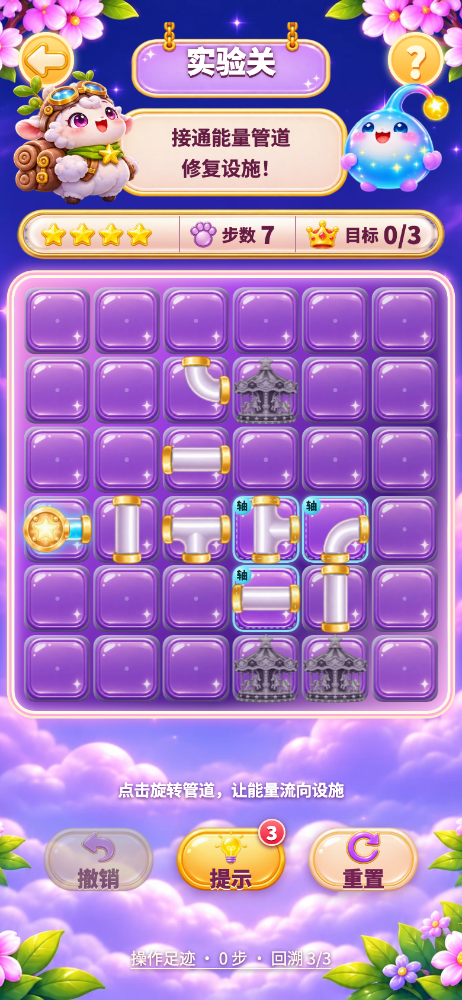
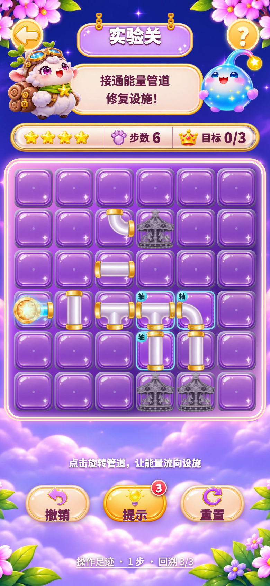
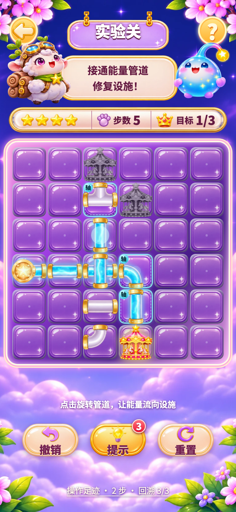
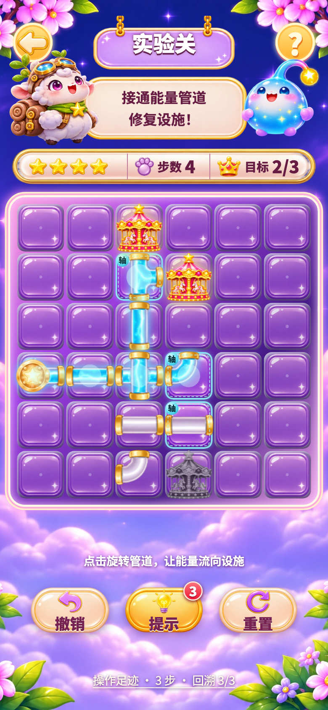
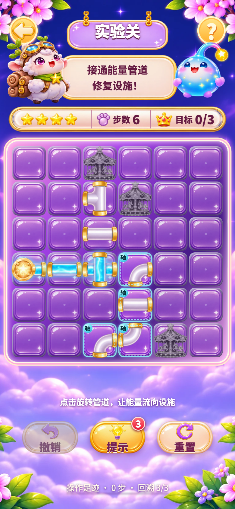
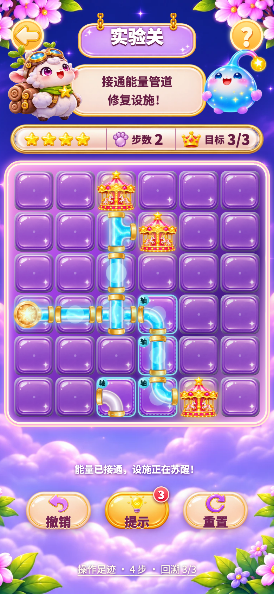

# 玩法切片 · 联动轴 P1 / P2 / P3（2026-11-14）

验证一件事：**联动轴（同一根轴上的格子一起转）能不能给这游戏带来第二个“啊哈”**。
三张实验关，不碰 99 关主线数据；首页右下角入口，编号 901 / 902 / 903。

| 原型 | 编号 | 教什么 | par | 预算 | 无联动轴时 |
|---|---|---|---|---|---|
| P1 合作 | 901 | 一拧三动：点一下，三处同归位 | 6 | 7 | 8（省 2） |
| P2 冲突 | 902 | 一拧就断：修顶部就毁掉右边的捷径 | 5 | 7 | 3（多花 2） |
| P3 忍住不修 | 903 | 轴上有一格永远歪着，别为它再拧 | 4 | 6 | 6（省 2） |

## P1 · 合作




## P2 · 冲突

右边那条路**一开始就是通的**（1/3）；拧一下轴修顶部，右边立刻黑掉（2/3）。




## P3 · 忍住不修

轴上四格：三格必须对，第四格（左下那根弯管）永远是歪的。
它开局指向主路，看起来是路的一部分；一旦拧轴，它就被甩到墙外，然后**再也不会对**。




第二张图是这一关的全部意义：**你赢了，而且还有一根管子是歪的。**

## 机制规格

- 同一 `axis` 的格子共转，点任意一格整组顺时针 90°，**整组只算 1 步**。
- 组内不放能量源 / 设施 / 锁石。
- 4 圈可还原，不存在死局，只存在“找不到共同相位”。
- 视觉：青色描边 + 虚线框 + “轴”标；`data-axis` 便于测试。

## 数据怎么算

`scripts/lab-par.ts`：枚举组的 4 个相位，把组内格按相位旋转后临时锁死，交给现成的
`solveMinTaps` 求其余格子的最少点击，总代价 = 相位 + 解。**求解器一行没改。**

> 教训：直管是 2 重对称（180° 等于 0°），所以直管永远只可能“需要 0 或 1 次点击”。
> 我手工排 P3 时按 4 重对称算错过一次，是 `lab:par` 把它纠正回来的。

## 改动清单

| 文件 | 改动 |
|---|---|
| `src/types/game.ts` | `Tile.axis?: string` |
| `src/App.tsx` | 联动旋转；`lab` 模式；补步道具 |
| `src/components/TileView.tsx` | 轴心标记与 `has-axis` 类 |
| `src/components/CandyThemeShell.tsx` | 三个实验关入口 / 标题 / 失败态道具按钮 |
| `src/index.css` | 轴样式、入口按钮 |
| `src/data/labLevels.ts` | 实验关数据（P1、P2、P3） |
| `scripts/lab-par.ts` | 带联动轴的 par 求解与校验 |
| `scripts/lab-playthrough.mjs` | CDP 端到端回归（真实点击 + 截图） |

## 复现

```bash
npm run build
npm run lab:par     # 逐关打印 par、组相位、无联动轴对比、与数据是否一致
npm run lab:play    # 起服务 + 无头 Chrome，跑完三关并截图到本目录
```

最近一次：P1 6 步通关、P2 5 步通关、P3 4 步通关，控制台 0 错误。

## 三关合起来的结论

1. **这块积木成立。** 省（P1）、赔（P2）、忍住（P3）三个动作都能被机制逼出来，而且都只用数据就能表达。
2. **最值钱的是 P3。** 现在 99 关的最优解约等于“把每根管子转一遍”（par/rot ≈ 1.04），
   P3 第一次要求玩家**不动**。这一条如果进主线，能直接改掉当前“无脑全拧”的解法习惯。
3. **风险仍然是“读不出来”。** 三关的机制差异全靠轴上那圈青色框；玩家如果没注意到框，
   P2 就是“莫名其妙的 bug”，P3 就是“我漏了一格”。正式上线前，轴的可视化必须再强化一档。
4. **成本**：三关总共约 40 行关卡数据 + 一次引擎改动（联动旋转）+ 两个脚本。加第四块积木基本是纯设计工作。

## 下一步

- 定积木形状：把 `Tile` 拆成“元件 + 修饰”，为限次旋转 / 双色 / 雾预留位置；
- 星级与失败条件一起重做（4★ = par + 8%，完美徽章 = par）；
- 轴的可视化强化（轴杆、同组联动动画）。
