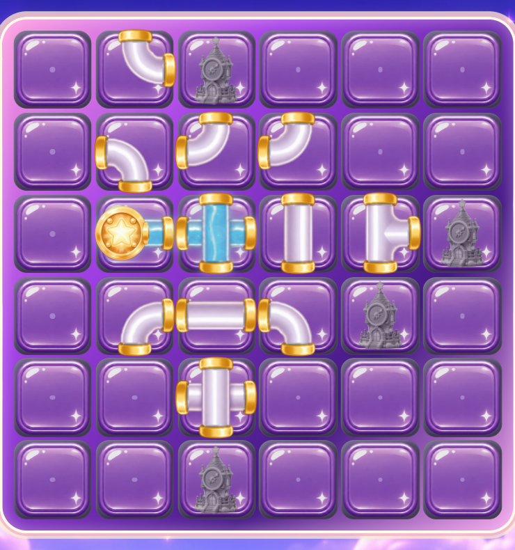
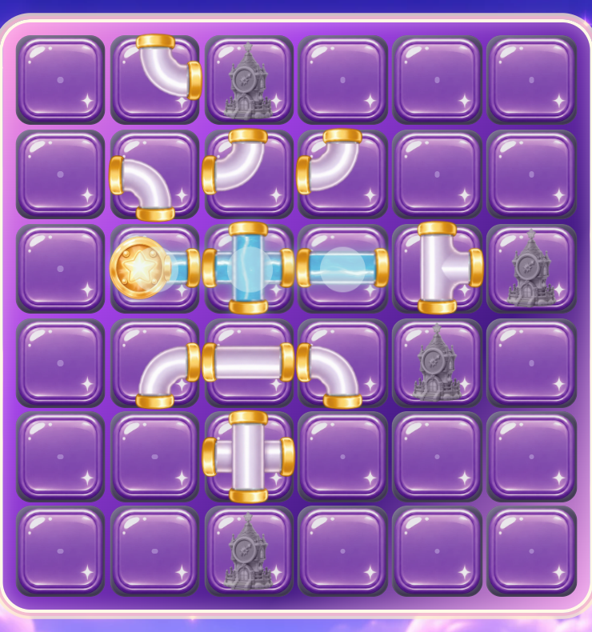
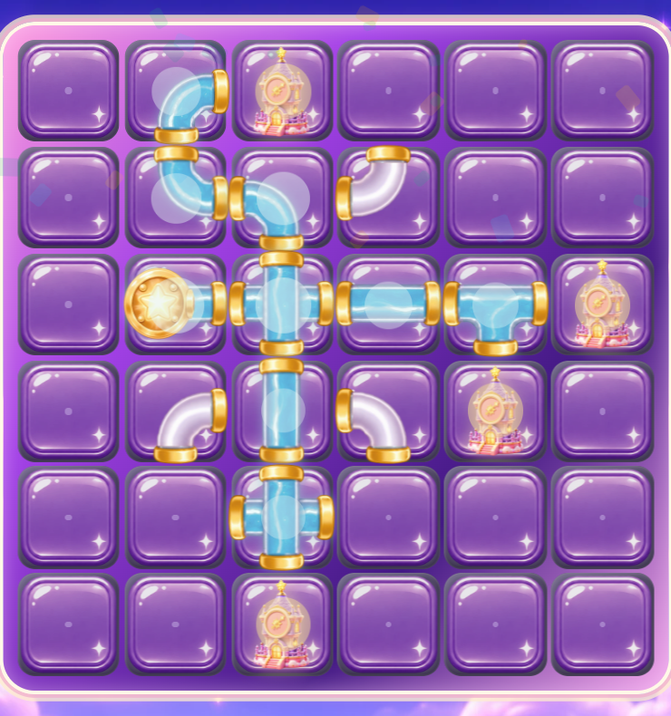

# 第 11 关「报时钟楼·报时」能量源朝向修复（2026-11-22）

## 现象

玩家反馈：第 11 关中央能量源外观只有一个朝右的接口，但盘面上、下、左、右四个方向都能被它点亮。

## 根因

- 规则与美术都只承认「单口朝右」的能量源：`getDefaultBasePorts('battery')` 返回 `RIGHT`；
  `scripts/audit_pipe_ports.py` 的 `EXPECTED.source = ('right',)`；贴图 `public/assets/park/pipe-source.webp` 也只有一个朝右接口。
- 第 11 关底盘是从旧图谱 L6 复刻的，而 `src/data/chapter1Levels.ts` 里该关能量源写成
  `"basePorts": 15`（UP|RIGHT|DOWN|LEFT 四向），于是模拟层把一个四向源接到了四臂中央，
  和单口外观直接冲突。
- 全 99 关只有这 1 处能量源是多向的（其余 175 处全部单口），属旧数据残留，不是通用规则。

## 修复

`scripts/chapter1-gen.ts` 新增 `buildL11`：手写解态盘面后交给 `scrambleSolved` 打乱，锁定 par 9。

- 中央四向元件改成合法的十字管（十字管本来就四面同形、不可转的枢纽，UI 也不会把它当可转按钮）；
- 能量源改成单口、贴在枢纽左侧朝右供能；
- 左臂那盏设施挪到右支路的三通上，保留 4 设施 / 3 条诱饵死路 / par 9 / maxSteps 12 的手感；
- 重新生成 `src/data/chapter1Levels.ts`，并更新布局指纹基线 `scripts/fixtures/level-layout-hash.json`（仅 L11 变化）。

## 防回归

- `scripts/audit-mainline.ts` 新增 **R8**：99 关每个能量源的解态端口必须恰好 1 个，多向源直接失败。
- `scripts/chapter-level-utils.ts` 的 `solvedBlueprint()` 拒绝把多向源的旧图谱当单口源蓝本，
  防止再有关卡复刻 L6 时把 bug 带回来。

## 验证

- `tsx scripts/test_chapter1.ts`：第 1 章 par 曲线 5/8/9/8/9/12/9/12/11/12/9/12/9/10/9/6/7/8/9/14，L11 = 9，通过。
- `audit-mainline`（含 R8）、`audit-distinct`（99 张互不为同一盘面）、`test_theme_content`（布局指纹）、
  以及 `package.json test` 里其余脚本全部通过；`tsc --noEmit` 无错误。
- 真机视口（Chrome 390×844 DPR2，对本机 dev server http://127.0.0.1:3000/）：
  - 开局 `目标 0/4`，只有能量源与中央十字通电（powered = t-2-1 / t-2-2），上下左无任何通电；
  - 只把源右侧那根直管转成横向后，新增通电只有右侧一格（t-2-3），再次证明没有别的方向漏电；
  - 按最优解点 9 步：`目标 4/4`、`操作足迹 9 步`，通关。

## 证据

| 开局（只有源 + 中央十字通电） | 只转右侧一格（只有右侧新增通电） | 9 步通关 |
| --- | --- | --- |
|  |  |  |

## 改动文件

- `scripts/chapter1-gen.ts`：新增 L11 手写解态 + `buildL11`，接线进 `buildChapter1`。
- `src/data/chapter1Levels.ts`：重新生成（仅 L11 变化）。
- `scripts/fixtures/level-layout-hash.json`：仅 L11 指纹更新。
- `scripts/audit-mainline.ts`：新增 R8 单口能量源审计。
- `scripts/chapter-level-utils.ts`：`solvedBlueprint()` 拒绝多向源蓝本。

## 遗留

- `minigame/`（独立小游戏工程，2026-11-09 后未更新）自带一份旧关卡快照，其 L6 也是四向源；
  不在本次主线修复范围内，若还要发行小游戏版本需单独修。
