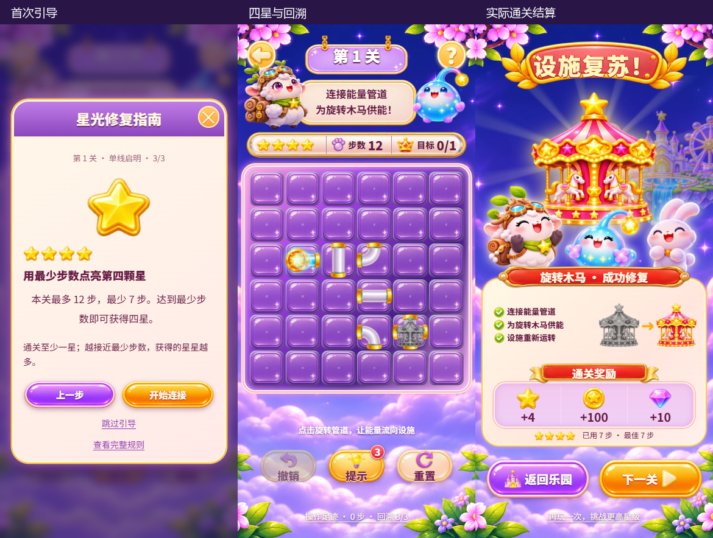

# master 合并与玩法视觉复验

日期：2026-11-11。合并输入：本地 `d9b789d` 与远端 `3df5d55`，保留双亲历史。

## 合并结果

主界面继续使用已完成的 UI 2.0 与修正后的管件贴图，保留真实奖励、背包、任务和商店闭环。远端四星评分、重排后的 99 关、最少步数、首次引导、触控计步修复、三次回溯、WebP 资源、小游戏工程和官方 npm 源更新一并保留。

评分统一调用 `src/utils/rating.ts`：首页、选关、实时评分、结算与成就使用同一口径，四星对应关卡最少步数。操作历史保存真实步数，连续输入读取同步状态，防止同一渲染间隔内丢步。回溯每轮 3 次，重试后恢复；引导和操作足迹明确显示规则。

新手三步内容改用当前乐园主题面板、正式管件和图标。首次故事与引导标记沿用主干存储键，实际通关后重载不会重复出现。通关进度、货币、奖励领取记录和成就保留；新版初始盘面对应主干第 4 版成绩记录，旧版最佳步数重新挑战后记录。已完成的自由演练关卡继续保留，未强制删除非连续进度。

通过 Git 差异核对，主干的关卡数据、评分模块、小游戏目录和忽略规则原样保留；本地管件贴图、`TileView` 与 `GameBoard` 对齐修复原样保留。PWA 的 id、入口、scope 和图标采用相对路径，同时保留当前产品名称与资源预缓存。

## 新鲜视觉证据



已打开并检查最终构建截图：四星栏完整，步数与目标无重叠；首次引导正文与按钮可读；修复清单、奖励、成绩和结算操作仍在面板内。星级从设计稿的三星示意改为主干四星规则。此前“设施复苏”弧形标题仍为待确认预览，本合并未加入该项变更。

## 验证

| 项目 | 结果 |
| --- | --- |
| 类型检查 | `npm run lint` 通过 |
| 玩法与进度 | 5 项关卡/电路回归与 9 项进度、四星、迁移需求验证通过 |
| 完整玩家路径 | 13 项实际点击与状态验证通过，覆盖新手、通关、奖励、兑换、库存、设置、图鉴、无尽、工坊及多尺寸 |
| 星级专项 | 11 次操作获一星，重玩 7 次获四星，只补 3 星，货币不重发 |
| 结算排版 | 7 种尺寸的清单、奖励、成绩与按钮均无交叠，且能继续下一关 |
| 管件素材 | 48 个方向/状态像素检查通过 |
| 管件实际玩法 | 新版首关与第 24、41 关的 8 个供能状态端口测量通过，允许误差 0.25 CSS 像素 |
| 合并规则专项 | 单次触控仅计一步、双击计两步、三次回溯限制、重试恢复、四星结算、重载保存通过 |
| 小游戏逻辑 | 19,204 条断言通过，0 失败 |
| 小游戏构建 | 微信、抖音与 Web 开发构建成功；未发布 |
| 正式资产与 PWA | 67 项资产与构建副本逐一一致，清单相对路径核对通过 |

[玩家路径](ui-test-results.json) · [星级提升](star-upgrade-results.json) · [七种尺寸](victory-layout-results.json) · [合并规则专项](merge-rules-results.json) · [管件像素](pipes/port-pixel-audit.json) · [管件运行坐标](pipes/runtime-port-results.json) · [源码与构建摘要](build-audit.json)

完整玩家路径与多尺寸检查在第一份合并候选执行，存档读取和相对图标入口收尾后重新构建，并在最终包追加触控、回溯、四星及保存专项和最终截图。两次执行时间和入口分别保留在结果文件中。

## 构建与复现

本机使用 `build/master-merge-2026-11-11-final/`，避开旧 `dist` 的字体文件占用；默认发布构建配置保持 `dist`，没有调整到临时目录。

```powershell
npm run lint
npm test
npm run build -- --outDir build/master-merge-2026-11-11-final
npm run preview -- --outDir build/master-merge-2026-11-11-final --host 127.0.0.1 --port 4181
# 另开终端
$env:PARK_TEST_URL='http://127.0.0.1:4181'
$env:PARK_QA_DIR='docs/QA/master-merge-2026-11-11'
$env:PARK_PIPE_QA_DIR='docs/QA/master-merge-2026-11-11/pipes'
npm run test:ui
npm run test:pipes
npm run test:merge
npm --prefix minigame test
npm --prefix minigame run build
```

本次没有安卓真机、小游戏原生宿主、广告、登录和声音听感验收。保留构建中单 JS 超过 500 kB 的体积提示，未将其隐藏。
