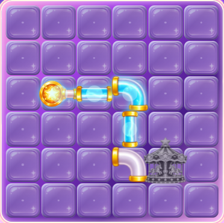
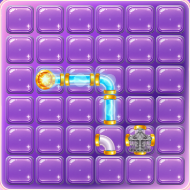
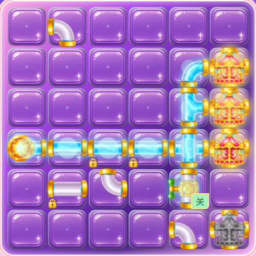
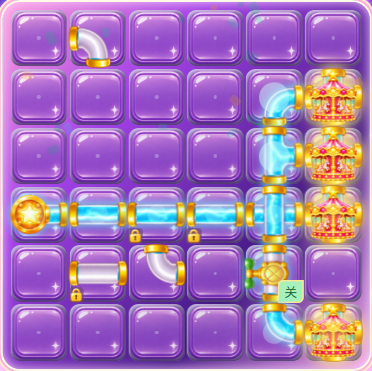
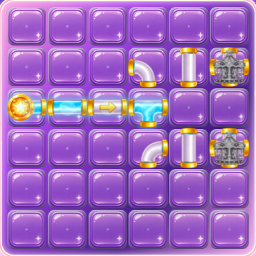

# 管件端口对齐修复与视觉复验

日期：2026-11-11。问题基线：`b419241`。用户确认按统一画布、端口、口径的方案修复全部管件，保留现有连通规则。

## 根因与处理

此前按贴图外轮廓裁边后将各管件放到画布中央，弯管的两条管道轴线、三通的分支交点和水闸的管道轴线随外轮廓漂移；统一放大到格子的 112% 又扩大了误差。棋盘格之间的留缝也成为实际接头间隙。

保留生成原件，通过端口中心、金属接头内外沿与统一管径将贴图标定到 512×512。所有管型、通能与未通能状态复用同一金属接头。旋转轴统一在画布中心，图像按格子 100% 显示；格子留缝改由背景内缩表现，实际连通边界相接。能量源右侧和设施四向入口使用同一套连接口，设施主体独立等比显示。

未修改关卡数据、步数消耗、能量仿真、奖励、存档和操作逻辑。

## 实际游玩截图

修复前：



修复后：









## 资产与运行测量

[深浅底与修复前后素材对照](before-after-alpha.png) · [前后 alpha 数据](before-after-alpha.json) · [四向旋转联系表](pipe-rotation-contact.png)

逐项解码检查实际发行贴图的 alpha 边界，覆盖 12 张贴图的四个方向，共 48 状态。连接口边缘带的可见口径均为 139 个素材像素，中心距标准边中心最多 0.5 个素材像素；测量依据为实际像素，未以清单坐标代替。[端口像素数据](port-pixel-audit.json)

使用独立浏览器上下文，真实点击进入第 1、24、41 关。读取旋转角度和开关状态，再根据实际通能边测量两侧贴图的连接口屏幕坐标，要求误差不超过 0.25 CSS 像素。覆盖 390×844、360×640 与 360×800 的首关，另覆盖水闸旋转、通断、三通、十字、单向管和四目标接通，共 10 个状态、55 条实际连通边，最大误差 0.116 CSS 像素。[运行测量结果](runtime-port-results.json)

`npm test` 的 5 项玩法回归与 8 项本地进度需求验证通过，`npm run lint` 与生产构建通过。`npm run test:pipes` 注册了素材与实际输入专项检查。没有运行全量 E2E；本轮修改未涉及其他玩法模块。

原图保存在 `docs/UI设计稿2.0/generated-sources/`。资产清单新增画布、旋转轴、端口和口径数据，并更新文件摘要。管件端口主动延伸到画布边界，其余透明区域与四角保持透明；边界接触为此类可拼接资产的预期形态。

本轮无在线设备验收，浏览器结论不包含安卓真机触控或听感。

## 发行包

67 项发行资产逐一与源资产摘要核对一致，源码与构建摘要见 [构建核验](build-audit.json)。本机旧 `dist/assets/park-font-BFx4nY0a.woff2` 被 Windows 占用，默认输出目录连续两次清理失败；改用以下独立发行目录后构建及端口专项通过，没有修改游戏配置来掩盖环境失败。

```powershell
npm run build -- --outDir build/ui2-2026-11-11
npm run preview -- --outDir build/ui2-2026-11-11 --host 127.0.0.1 --port 4173
npm run test:pipes
```

当前试玩：<http://127.0.0.1:4173/>。发行压缩包：`build/Energy-UI2-Web-2026-11-11.zip`。本次修复以该目录和截图为准，旧 `dist` 不作为最新交付包。
