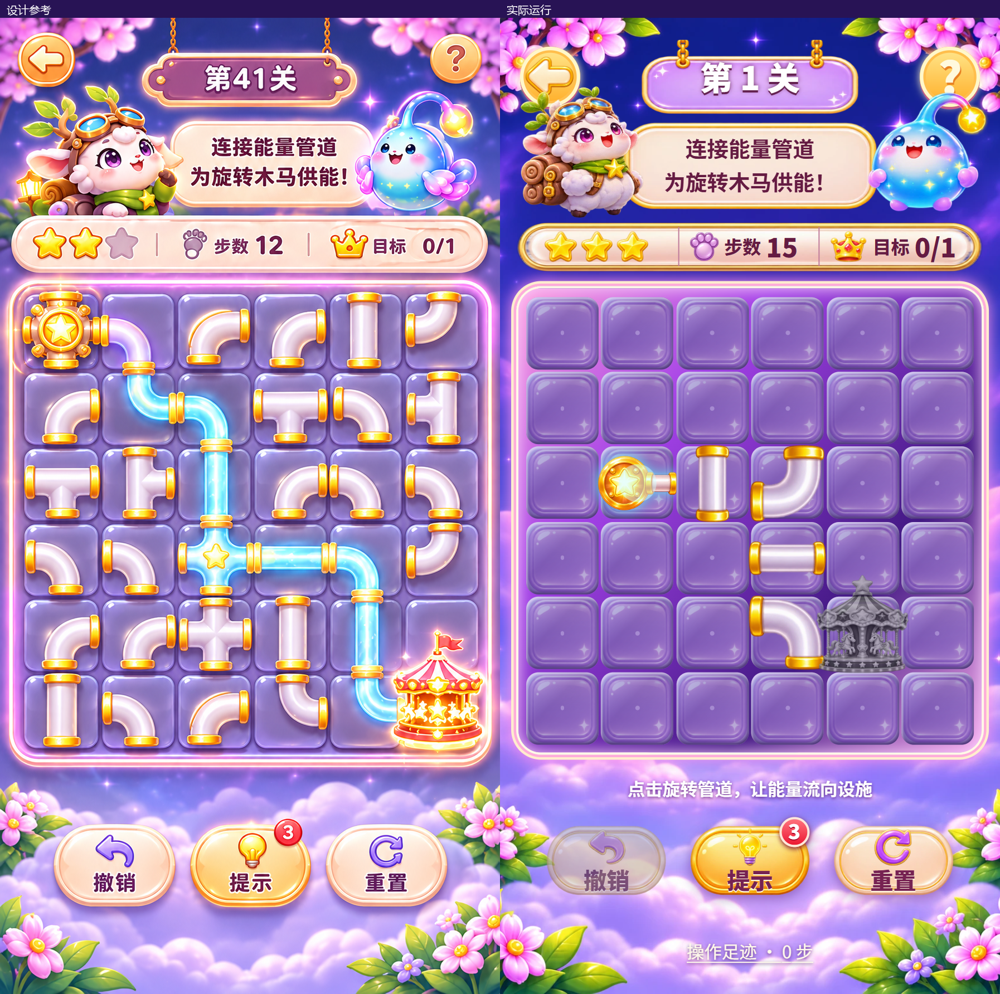

# 能量管道乐园 UI 2.0 视觉与功能交付报告

日期：2026-11-10。平台：React / Vite Web 生产构建。设计依据：`docs/UI设计稿2.0/1.png`、`2.png`、`3.png`。本轮接续已确认的全面重构方案，完成页面、美术接入和玩家路径验收。

2026-11-11 更正：用户反馈管件接头错位，经实际截图确认，原报告的管件对齐验收不充分。`b419241` 的逻辑连通通过不能证明画面端口对齐。修复与新鲜证据见 [管件对齐复验报告](../pipe-alignment-2026-11-10/visual_validation_report.md)，下方历史截图与原测试记录保留原范围。

## 交付内容

首页、真实棋盘与结算采用独立背景、角色、设施、牌匾、管件和图标。资源、通关进度、星级、目标与奖励由当前游戏数据呈现。选关、图鉴、成就、任务、背包、商店、设置、规则、历史、无尽与工坊均有可达入口并使用统一主题。

保留 99 关、旋转、四向分流、能量闸旋转及通断、单向管、多源多目标、撤销、重做、操作足迹、最佳成绩、成就、图鉴和本地存档。通关完成后落盘首次奖励；重玩只提升最佳成绩和星级差额。每日任务按本地自然日领取一次，兑换同时扣金币并增加库存，提示使用后扣减库存。

## 视觉证据

下列对照保持两侧原始尺寸一致，没有拉伸截图。左侧为设计参考，右侧为真实运行。





[全部状态截图联系表](screen-contact.png) · [截图与源码、构建摘要](delivery-audit.json) · [像素差诊断](home-difference.png)

截图覆盖 390×844、设计首页 361×727、设计玩法 897×1752、设计结算 897×1754，以及 720×1280、1080×1920、1080×2400 输出。`360x640` 文件名对应 360×640 CSS 视口、DPR 3；`360x800` 对应 360×800 CSS 视口、DPR 3。

检查重点为文字完整、按钮命中、无屏外内容、角色与设施等比显示、透明边缘、管件朝向、通能前后状态、禁用与耗尽反馈、窄屏与长屏布局。原稿中的示例余额、关卡和目标数量随真实游戏状态变化。

## 美术与字体检查

统一资产清单：[manifest.json](../../../public/assets/park/manifest.json)。67 项资产保留尺寸、原件、切片、处理方式和 SHA-256；发行构建与源资产逐项核对。背景为完整不透明图，其余切片核对真实透明通道和四角。角色、设施使用 `object-fit: contain` 等比呈现，旋转管件与逻辑端口对应。

本轮新增 `ui-details-v2.png` 和 `wide-panels-v2.png`，通过 images API / gpt-image-2 生成，采用 rembg 去底与透明裁边，接入商店建筑、设置按钮、奖励牌、修复牌和状态条。备用设施框保留在资产清单，未用于当前关卡卡片。首版面板比例不适合长条控件，已重新生图并以新截图验收。

[补充资产深浅底检查](details-alpha-contact.png) · [透明与裁切数据](details-alpha-audit.json) · [全资产联系表](asset-contact.png) · [原件与提示词记录](../../UI设计稿2.0/generated-sources/generation-records.json)

既有 12 张原图继续复用，旧批次完整提示词未保存在仓库，保留现有来源记录。本轮修复加工脚本对已失效缓存目录的依赖，优先读取仓库原件，已成功重跑。字体使用 Noto Sans SC，1052 个中文字符子集核查无缺字；SIL OFL 许可随源码和发行资源保留。

动态反馈为已有音效、静态切图、旋转补间、供能脉冲、设施浮动与结算粒子；没有新增角色序列帧动画。截图中的待机、供能、灰色设施与复苏状态来自真实操作。

## 功能与玩家路径

| 验证 | 结果与证据 |
| --- | --- |
| `npm run lint` | 类型检查通过 |
| `npm test` | 5 项玩法回归及 8 项进度需求验证通过；包含 99 关结构完整性 |
| `npm run build` | 生产构建通过，PWA 预缓存包含当前主题资产 |
| `npm run test:ui` | 13 项路径与状态验证，另含星级提升专项与 7 种尺寸结算排版专项；结果见下方 JSON |
| 资产与构建审查 | 逐项核对摘要、尺寸、原件、透明角点和发行副本；见 `delivery-audit.json` |

[玩家路径结果](ui-test-results.json) · [星级提升结果](star-upgrade-results.json)

[实际点击试玩录像](player-flow.webm) · [录像解码记录](video-audit.json)。录像为 390×844、25 帧/秒、约 144 秒，已解码检查首帧。

试玩使用 Chrome 独立上下文，通过页面按钮与棋盘点击进入关卡，不向游戏注入解锁、胜利或货币状态。已覆盖：

- 新玩家进入第一关、逐次旋转、通能、撤销、历史回退、重置、完成与下一关。
- 首通奖励、重玩奖励去重、任务资格、领取、兑换、库存、提示消耗及页面重载恢复。
- 步数耗尽后的撤销与重试；最后一步完成、一星提升三星只增加两颗星。
- 第 24 关水闸旋转与通断、分支及四目标；第 41 关单向管方向与双目标；第 61、81 关双源、多目标及组合管件。
- 设置、规则、成就、图鉴及详情、故事与来信；无尽生成后的实际操作。
- 工坊实际绘制、导出导入、进入试玩并完成。

## 还原差异与覆盖边界

原稿棋盘是 5×6，现有关卡是 6×6，本轮保留玩法布局。第 41 关显示现有数据中的双目标，首页显示真实余额与进度。预览卡片保留现有选关能力，首次进入为“开始挑战”。这些差异可在截图中核对。

原尺寸复查发现结算页按百分比划分的奖励区挤压修复清单，内联勾选图标的基线又额外撑高文本行。已调整面板高度、改为逐行对齐图标、调整牌匾位置，并补充七种尺寸下清单、奖励、成绩与按钮不交叠的实际通关验证：[结算排版复验](victory-layout-results.json)。功能路径在排版调整前完整执行，最终 CSS 使用此专项复验；两次记录均保留实际时间。星级提升与工坊结算截图在修复后重新拍摄。

新生成角色、城堡、设施和背景细节，以及中文字体笔形，仍与原稿存在差异。像素差输出用于定位区域，不作为还原百分比；未宣称像素级一致。已检查主页面与关键状态中的文字、边缘、材质和操作反馈。

99 关结构全部检查，浏览器逐关操作覆盖第一关及四个章节代表关卡，没有逐一人工通关全部 99 关。旧存档迁移通过进度模块需求测试，未操作用户现有档案。音效与震动设置经过按钮验证，人工听感和实体震动未验收。

Mobile MCP 枚举没有在线设备。本轮没有安装 APK、真机触控或外部发布。Android 名称、图标和启动图已同步到源码，其构建与设备验收不包含在本次 Web 结论中。

构建保留单个 JS 超过 500 kB 的体积提示；类型检查、资源加载与本次浏览器路径通过。第一次试玩因本地缺少 Playwright 录屏依赖中断，安装 FFmpeg 后重新完整执行；旧截图和未完成运行不作为本次通过证据。

## 复现与交付

```powershell
npm ci --legacy-peer-deps
npm run lint
npm test
npm run build
npm run preview -- --host 127.0.0.1 --port 4173
# 另开终端
$env:PARK_TEST_URL='http://127.0.0.1:4173'
npm run test:ui
python scripts/audit_park_delivery.py
```

试玩入口：<http://127.0.0.1:4173/>。生产构建为 `dist/`；源码与构建文件摘要由 `delivery-audit.json` 绑定。交付压缩包在 `build/Energy-UI2-Web-2026-11-10.zip`。

本轮可复用改进：原件随仓库保存并优先读取、统一资产清单核验、按 CSS 视口与 DPR 记录截图尺寸、先完成真实玩家路径再生成原稿对照。这些检查已在本项目运行；跨项目适用性尚未评估，未修改公共工厂实现。
