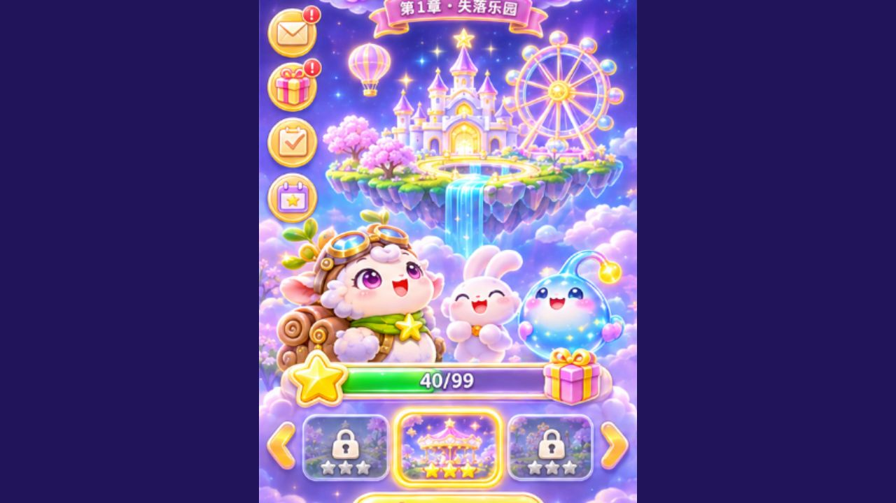
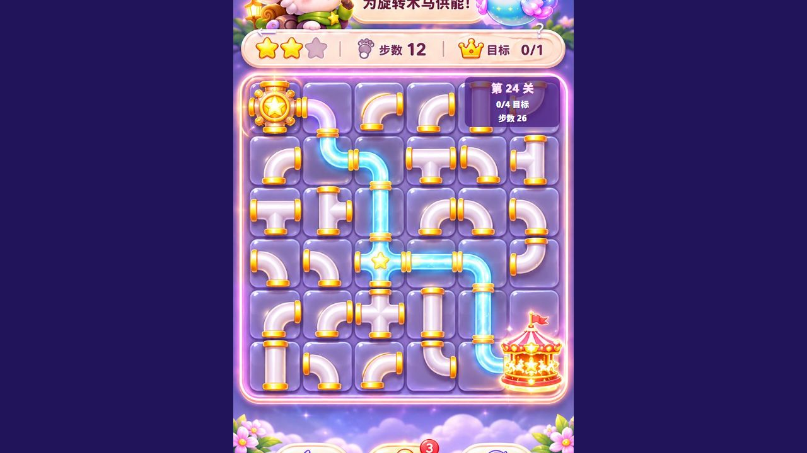
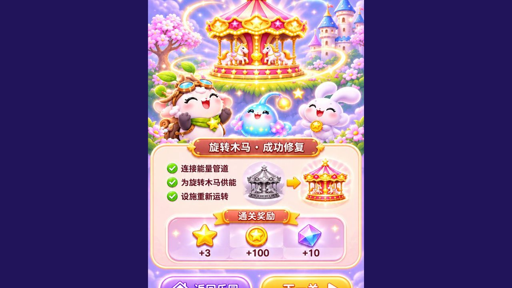
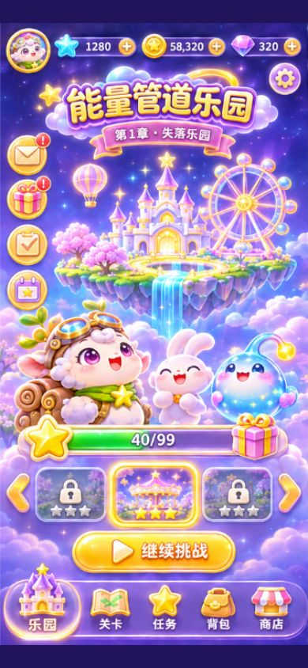
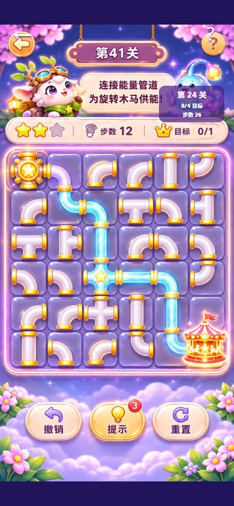

# UI 2.0 视觉与功能验收报告

验收日期：2026-11-10

## 验收范围

- 首页参考稿 `1.png`
- 玩法参考稿 `2.png`
- 结算参考稿 `3.png`
- 实现入口 `http://localhost:3000/`

## 已验收页面

首页使用浮空乐园、星空云海、角色、设施卡、进度条和底部导航构图。设计稿中的按钮由透明点击区域承接，入口可打开关卡、任务、背包、商店、个人资料与规则。

玩法页保留设计稿的珍珠白管道和紫金棋盘视觉。6×6触摸区域映射现有关卡瓦片，旋转、水闸通断、撤销、提示和重置继续使用原玩法状态。顶部状态显示真实关卡、目标和剩余步数。

结算页使用设施复苏构图，返回乐园和下一关使用透明点击区域承接。通关后发放星星、金币和钻石并写入本地存档，商店弹层读取实时金币余额。

任务页可领取每日金币奖励。背包里的提示灯泡会打开当前关卡提示。商店可用金币兑换提示道具，余额不足时不会扣费。

## 真实试玩记录

1. 首页点击“继续挑战”进入第24关。
2. 旋转第24关管道后，目标状态和步数同步变化。
3. 返回关卡选择，进入第1关并完成四段真实旋转。
4. 第1关目标由 `0/1` 变为 `1/1`，剩余步数由 `15` 变为 `6`。
5. 进入“设施复苏”结算页，奖励写入本地存档，商店弹层读取到 `58,330` 金币并可兑换提示道具。
6. 重新进入第1关，结算延时正常显示，未被最佳步数存档更新提前取消。
7. 在 390×844 视口检查首页，主要构图、按钮和底部导航保持在屏内。

## 自动化检查

- `npm run lint` 通过。
- `npm test` 通过，99关结构、首关通路、水闸、单向管和第24关回归共 `5/5 PASS`。
- `npm run build` 通过，PWA 资源生成完成。

## 截图证据

以下截图来自本轮本地浏览器运行，保存时间为 2026-11-10。截图中可见设计稿背景、实际玩法状态和结算页面。

390×844 竖屏截图：

## 资产检查

本轮新增资产分为一项生图资产和三项设计稿运行时副本。

| 文件 | 来源 | 规格 | 用途 |
| --- | --- | --- | --- |
| `public/assets/ui2-mascots.webp` | 图像生成工具生成，透明背景 | 1024×683，RGBA，167 KB | 任务、背包和商店弹层中的羊、兔子与蓝色能量精灵 |
| `public/assets/ui2-home.png` | `docs/UI设计稿2.0/1.png` 的运行时副本 | 361×727，RGBA，600 KB | 乐园首页完整场景 |
| `public/assets/ui2-play.jpg` | `docs/UI设计稿2.0/2.png` 的压缩副本 | 720×1406，RGB，215 KB | 玩法页完整场景与管道材质 |
| `public/assets/ui2-victory.jpg` | `docs/UI设计稿2.0/3.png` 的压缩副本 | 720×1408，RGB，228 KB | 设施复苏结算场景 |

生图资产提示词要求三只原创糖果幻想风角色，包含护目镜白羊、紫色兔子和蓝色能量精灵，透明背景，无文字和水印。三张页面设计稿由用户提供，本轮保留其完整合成构图，只生成压缩运行时副本以避免 PWA 预缓存文件过大。管道交互继续复用项目已有管件、起点和终点资产。

## 视觉结论

首页、玩法页和结算页在默认桌面视口与 390×844 视口完成真实截图检查。标题、角色、设施、棋盘、按钮和底部导航没有出现运行时溢出。玩法页的动态状态采用小型紫色状态牌承载，避免覆盖设计稿内的固定说明牌。

截图已保存到本目录的 `runtime-screens`，包含默认浏览器视口和 390×844 竖屏视口。本轮截图为浏览器运行证据，Android 真机安装与连续游玩仍需在连接设备后执行。
