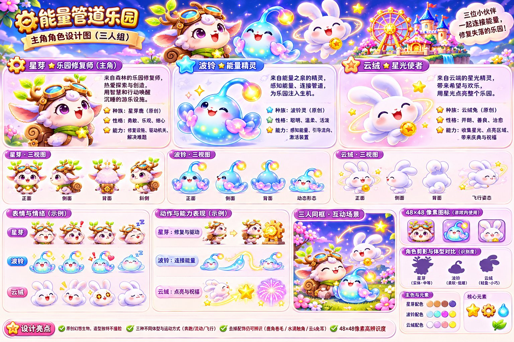

# 能量管道乐园 · 主角角色设定集

> 三位小伙伴一起连接能量，修复失落的乐园。

| 项目 | 内容 |
| --- | --- |
| 文档版本 | v1.1 |
| 整理日期 | 2026-11-21 |
| 文档状态 | 已按用户确认更新：星芽＝鹿形、云绒双身份融合、情绪与头像资产补齐 |
| 适用范围 | H5 / 微信抖音小游戏 / Android，共用同一套角色设定 |
| 角色正名 | 星芽、波铃、云绒 |
| 设计图来源 | 用户提供《主角角色设计图（三人组）》，1536×1024 JPEG |
| 关联设定 | `src/content/world.ts`、`src/content/zones.ts`、`docs/superpowers/specs/2026-11-12-park-universe-theme-design.md`、`assets/energy_park_art_pack_v1/README_素材使用说明.md` |

## 0. 先说结论：原来有没有人物介绍文档？

没有独立的“人物介绍 / 角色设定”文档。此前与三位角色有关的信息分散在 4 处：

| 来源 | 现有内容 | 局限 |
| --- | --- | --- |
| `src/content/world.ts` | 4 人 cast：小羊、白兔、能量精灵、熊猫园长，每人一句职责 | 名称是旧称；没有种族、外观、配色、表情、动作规范 |
| `docs/superpowers/specs/2026-11-12-park-universe-theme-design.md` | 一行角色定位：小羊＝玩家化身、白兔＝游客/图鉴记录员、能量精灵＝向导、熊猫＝园长 | 只有功能分工，没有视觉设定 |
| `assets/energy_park_art_pack_v1/README_素材使用说明.md` | 出现“星芽、波铃、云绒”三个名字与素材目录 | 没有逐角色介绍 |
| `docs/UI设计稿2.0/视觉功能验收报告.md`、`docs/superpowers/specs/2026-11-20-shop-expansion-design.md` | 旧称“护目镜白羊、紫色兔子、蓝色能量精灵”“羊、兔子、精灵” | 称呼不统一，和设计图对不上 |

本文件把设计图信息与此前散落的设定合并，作为项目内角色 IP 的**唯一设定源**。

## 0.1 已确认决议（2026-11-21）

1. **星芽是鹿，不是羊**：种族定为「星芽鹿」，旧称小羊 / 白羊 / 护目镜小羊全部作废；运行时代码只保留 `sheep` 作为内部 ID，显示名统一为星芽。
2. **云绒两个身份融合**：主身份「星光使者」，副身份「图鉴记录员」；点亮、庆祝与记录藏品由同一角色承担，不再拆成两个设定。
3. **资产补齐**：三类缺口全部交付——15 张表情（5 情绪 × 3 角色）、3 组 48/96 角色头像、云绒庆祝姿态；同时修复旧表情贴图残缺问题。执行明细见 `docs/QA/character-ip-2026-11-21/`。

## 1. 三人组总览

| 角色 | 称号 | 定位 | 种族 | 性格 | 能力 | 体型 / 运动 | 核心元素 |
| --- | --- | --- | --- | --- | --- | --- | --- |
| 星芽 | 乐园修复师（主角） | 玩家化身、行动派主角 | 星芽鹿（原创） | 勇敢、乐观、细心 | 修复设施、驱动机关、解决难题 | 实体·中等 / 奔跑 | 齿轮、叶片 |
| 波铃 | 能量精灵 | 能量向导、规则解释者 | 波铃灵（原创） | 聪明、温柔、活泼 | 感知能量、引导流向、激活装置 | 柔软·低矮 / 流动 | 水滴 |
| 云绒 | 星光使者 | 星光使者 / 图鉴记录员 | 云绒兔（原创） | 开朗、善良、治愈 | 收集星光、点亮区域、记录藏品、带来庆典与祝福 | 轻盈·小巧 / 飞行 | 星星 |

三人组不是并列的装饰，而是一条完整的动作链：

1. **星芽「修复」**：醒来、上手，把坏掉的设施修好。
2. **波铃「连接」**：感知能量、引导流向，把管道接通。
3. **云绒「点亮」**：收下星光、点亮区域，用庆典收尾。

对应游戏循环：**修复设施 → 接通能量 → 点亮乐园 → 吸引游客 → 解锁新区域**。

## 2. 角色卡

### 2.1 星芽 · 乐园修复师（主角）

| 字段 | 内容 |
| --- | --- |
| 中文名 | 星芽 |
| 拼音 / 资产 ID | Xingya / `xingya` |
| 称号 | 乐园修复师（主角） |
| 定位 | 玩家化身；负责“动手修好”的那一个 |
| 种族 | 星芽鹿（原创，鹿形幻想生物） |
| 出身 | 森林 |

> 来自森林的乐园修复师，热爱探索与创造，用智慧和行动唤醒沉睡的游乐设施。

**性格**：勇敢、乐观、细心。遇到坏掉的设施会先眼睛发亮，再蹲下来检查每个接口；不怕失败，但在意有没有把细节做对。

**能力**：修复设施、驱动机关、解决难题。

**外观要点**：

- 奶油白 / 浅杏色的鹿崽，圆脸大眼，紫罗兰色瞳孔；
- 头顶一对卷曲木质鹿角，枝头长嫩绿叶芽；
- 额前架着铜色护目镜（蓝绿镜片），一对大圆耳，内耳粉色；
- 草绿围巾，正中一枚金色五角星徽章；
- 背后背着铜色工具卷 / 工具箱，带齿轮扣；
- 短腿、小圆尾，整体是“实体·中等”身材。

**识别与禁改点**：鹿角＋叶芽、护目镜、绿围巾＋星章、紫瞳、工具包。去掉配饰后仍要能靠“鹿角卷毛”认出他，这五项不要随意删除或改色。

**三视图**：正面、侧面、背面、斜侧（斜侧用于首页 / 对话立绘）。

**动作表现**：修复与驱动——星芽操作齿轮组，装置随之运转，设施复苏。

**表情**：开心、眨眼、睡觉、惊讶、星星眼。

**主色**：奶杏、暖橙、栗棕、星夜紫（眼睛）。

**核心元素**：齿轮（机关与修复）、叶片（森林出身）。

### 2.2 波铃 · 能量精灵

| 字段 | 内容 |
| --- | --- |
| 中文名 | 波铃 |
| 拼音 / 资产 ID | Boling / `boling` |
| 称号 | 能量精灵 |
| 定位 | 能量向导；负责解释规则、把能量接上 |
| 种族 | 波铃灵（原创） |
| 出身 | 能量之泉 |

> 来自能量之泉的精灵，感知能量、连接管道，为乐园注入生机。

**性格**：聪明、温柔、活泼。好奇心强，喜欢贴着管道听能量流动；解释规则时不居高临下，会用“顺着光走”这样的比喻。

**能力**：感知能量、引导流向、激活装置。

**外观要点**：

- 水滴 / 铃铛形的软体精灵，蓝青渐变，果冻与泉水质感；
- 身体内部有星星点点的微光；
- 头顶一根卷曲触角，末端是发光的黄色能量球；
- 黑豆眼、笑口、粉腮；两侧三瓣半透明的粉紫小手 / 鳍；
- 底部是裙摆状的柔软边缘，没有明显的腿。

**识别与禁改点**：触角＋末端光球、蓝青渐变、粉紫小手、低矮柔软体型。去掉配饰后靠“水滴触角”剪影识别。

**三视图**：正面、侧面、背面、动态形态（背面用动态形态替代，方便表现流动感）。

**动作表现**：连接能量——身体延展成光带，把能量导进管道与装置。

**表情**：开心、眨眼、睡觉、惊讶、星星＋爱心眼。

**主色**：雾蓝、薄荷青、糖果品红、亮黄。

**核心元素**：水滴。

### 2.3 云绒 · 星光使者

| 字段 | 内容 |
| --- | --- |
| 中文名 | 云绒 |
| 拼音 / 资产 ID | Yunrong / `yunrong` |
| 称号 | 星光使者 |
| 定位 | 星光使者（主）/ 图鉴记录员（副）；负责点亮、庆祝与藏品记录 |
| 种族 | 云绒兔（原创） |
| 出身 | 云端 |

> 来自云端的星光精灵，带来希望与欢乐，用星光点亮整个乐园。

**性格**：开朗、善良、治愈。负责庆祝、安抚，把好消息说出来；玩家失败时也在旁边陪着。

**能力**：收集星光、点亮区域、带来庆典与祝福；同时记录每一件被修复的乐园藏品。

**外观要点**：

- 云朵质感的纯白兔，耳内与身体边缘是淡紫色；
- 粉腮、眯眼笑，脸颊蓬松；
- 胸前挂着金色星星奖章 / 怀表；
- 身后有金色星环，脚下踩着小云朵，整体悬浮；
- 体型轻盈小巧，动作以飞行为主。

**识别与禁改点**：云朵兔耳、星星奖章、白＋淡紫配色、飞行姿态。去掉配饰后靠“长兔耳＋云朵轮廓”识别。

**三视图**：正面、侧面、背面、飞行姿态。

**动作表现**：点亮与祝福——撒星、星火、烟花，点亮一整片区域。

**表情**：开心、眨眼、睡觉、惊讶、闪光眼。

**主色**：云白、淡紫、樱粉、星黄。

**核心元素**：星星。

### 2.4 配角：熊猫园长

本轮三人组设计图未包含熊猫园长，视觉暂未重设。保留 `src/content/world.ts` 中的功能定位：发布任务、介绍新区域、管理世界地图。不要因为三人组更新而删除此角色设定。

## 3. 视觉规范

### 3.1 配色

| 角色 | 参考色（设计图取样） | 用法建议 |
| --- | --- | --- |
| 星芽 | `#F9B97A` 奶杏 / `#E9994E` 暖橙 / `#B96455` 栗棕 / `#704FBD` 星夜紫 | 皮肤与鹿角用奶杏、暖橙；工具与护目镜用栗棕；眼睛与标题描边用星夜紫 |
| 波铃 | `#C2E3FA` 雾蓝 / `#8DFAEE` 薄荷青 / `#EF4AF5` 糖果品红 / `#FBF23C` 亮黄 | 身体由雾蓝渐变到薄荷青；小手与腮用糖果品红；触角光球用亮黄 |
| 云绒 | `#FCFAFD` 云白 / `#F0BBF8` 淡紫 / `#FA9BA9` 樱粉 / `#FCF43A` 星黄 | 主体云白，耳内与边缘淡紫；腮用樱粉；星章与星环用星黄 |

> 色值由设计图色板取样（±），仅作规范参考；正式资产颜色以 `public/assets/park/manifest.json` 和实机 PNG / WebP 为准。

### 3.2 核心元素

| 元素 | 含义 | 归属（建议） |
| --- | --- | --- |
| 星星 | 星光、奖励、点亮 | 云绒；同时也是乐园主线符号 |
| 齿轮 | 机关、修复、驱动 | 星芽 |
| 水滴 | 能量、流动、连接 | 波铃 |
| 叶片 | 森林、生长、生命 | 星芽（出身） |

### 3.3 剪影、体型与运动方式

| 角色 | 剪影关键词 | 体型 | 运动方式 | 去配饰识别点 |
| --- | --- | --- | --- | --- |
| 星芽 | 分叉鹿角＋圆耳＋工具包 | 实体·中等 | 奔跑 | 鹿角卷毛 |
| 波铃 | 圆水滴＋单根卷触角 | 柔软·低矮 | 流动 | 水滴触角 |
| 云绒 | 长兔耳＋云朵尾＋星环 | 轻盈·小巧 | 飞行 | 云朵兔耳 |

> 设计图明确要求：三种不同体型与运动方式（奔跑 / 流动 / 飞行）；去掉配饰仍可辨识；48×48 像素下仍要能认人。

### 3.4 三人同框构图

- 海报 / 活动图：星芽在画面中前部，波铃在右侧，云绒在上方飞行撒星；
- 背景：摩天轮、城堡、花海与烟花，保持“失落乐园被点亮”的氛围；
- 首页三个伙伴槽位沿用现有实现与站位，不按海报比例重排；换装、换表情只替换图，不改容器尺寸、底边与中心点。

## 4. 图标 / 表情 / 动作资产规范

### 4.1 48×48 像素图标

- 底框：圆角方形，紫到粉渐变，白色内描边（按设计图样式）；
- 内容：只保留头部与标志性配饰——星芽的护目镜＋鹿角、波铃的触角光球、云绒的兔耳＋星章；
- 优先级：轮廓 > 眼睛 / 表情 > 配饰 > 细节纹理，小尺寸不放背景故事元素；
- 交付：透明背景 PNG / WebP，48×48 为 1x，另出 96×96、144×144 两档；亮底和暗底各验一次透明边缘；
- 现状：已交付 `avatar-xingya.webp`、`avatar-boling.webp`、`avatar-yunrong.webp`（48×48）及同名 `@2x`（96×96）两档，登记在 `public/assets/park/manifest.json`；96×96 档已接入「修复手册」的乐园伙伴区。

### 4.2 表情矩阵

表情源文件统一为 5 种情绪 × 3 角色，位于 `assets/energy_park_art_pack_v1/02_characters/expressions/{id}_{state}.png`，宽度 144px。

| 情绪 | 星芽 | 波铃 | 云绒 | 源文件 |
| --- | --- | --- | --- | --- |
| 开心 | 眯眼笑、张嘴 | 眯眼笑、粉腮 | 眯眼笑 | `{id}_happy.png` |
| 眨眼 | 单眼眨眼、笑意 | 单眼眨眼、粉腮 | 单眼眨眼 | `{id}_wink.png` |
| 睡觉 | 闭眼、放松 | 闭眼、放松 | 闭眼、放松 | `{id}_sleep.png` |
| 惊讶 | 睁大眼、张嘴 | 睁圆眼、张嘴 | 睁大眼、张嘴 | `{id}_surprised.png` |
| 星星眼 | 星星瞳 | 星星＋爱心眼 | 闪光眼 | `{id}_sparkle.png` |

> 2026-11-21 重新绘制了全部 9 张旧表情（原图是从合图里切错的残片），并新增惊讶、星星眼 6 张。首页「开心问候」直接使用其中的 happy 表情，`mood-*.webp` 已同步重出。

### 4.3 动作演示

| 角色 | 动作 | 表现 | 现有运行时资产 |
| --- | --- | --- | --- |
| 星芽 | 修复与驱动 | 星芽操作齿轮组，装置运转、设施复苏 | `sheep.webp`、`sheep-cheer.webp` |
| 波铃 | 连接能量 | 身体延展成光带，接通管道与装置 | `spirit.webp`、`spirit-cheer.webp` |
| 云绒 | 点亮与祝福 | 撒星、星火、烟花点亮区域 | `rabbit.webp`、`rabbit-cheer.webp` |

## 5. 资产索引

### 5.1 源素材（美术包）

| 角色 | 主立绘 | 表情 |
| --- | --- | --- |
| 星芽 | `assets/energy_park_art_pack_v1/02_characters/xingya_main.png` | `assets/energy_park_art_pack_v1/02_characters/expressions/xingya_{happy,wink,sleep,surprised,sparkle}.png` |
| 波铃 | `assets/energy_park_art_pack_v1/02_characters/boling_main.png` | `assets/energy_park_art_pack_v1/02_characters/expressions/boling_{happy,wink,sleep,surprised,sparkle}.png` |
| 云绒 | `assets/energy_park_art_pack_v1/02_characters/yunrong_main.png` | `assets/energy_park_art_pack_v1/02_characters/expressions/yunrong_{happy,wink,sleep,surprised,sparkle}.png` |

### 5.2 运行时素材

| 用途 | 文件 |
| --- | --- |
| 首页主立绘 | `public/assets/park/sheep.webp`、`public/assets/park/rabbit.webp`、`public/assets/park/spirit.webp` |
| 庆祝姿态 | `public/assets/park/sheep-cheer.webp`、`public/assets/park/spirit-cheer.webp`、`public/assets/park/rabbit-cheer.webp` |
| 星愿礼服 | `public/assets/park/outfit-sheep-starlight.webp`、`public/assets/park/outfit-rabbit-starlight.webp`、`public/assets/park/outfit-spirit-starlight.webp` |
| 开心问候表情 | `public/assets/park/mood-sheep-happy.webp`、`public/assets/park/mood-rabbit-happy.webp`、`public/assets/park/mood-spirit-happy.webp`、`public/assets/park/mood-joy.webp` |
| 角色头像 | `public/assets/park/avatar-xingya.webp`、`avatar-boling.webp`、`avatar-yunrong.webp`（48×48）及同名 `@2x`（96×96） |
| 资源清单 | `public/assets/park/manifest.json`、`public/assets/park/shop-assets.json` |

> 运行时主立绘 `sheep.webp` 等来自旧的 `characters.png` 合图，不一定与本次三视图完全一致；后续换装、补表情时以本文档三视图为准重新核对。2026-11-21 的 `mood-*.webp` 已按新表情重出，`avatar-*` 与 `rabbit-cheer.webp` 为新增运行时资产。

### 5.3 正名 / 旧称 / ID 映射

| 正名 | 源素材 ID | 运行时 Art name | 旧称（需逐步淘汰） |
| --- | --- | --- | --- |
| 星芽 | `xingya` | `sheep`、`sheep-cheer` | 小羊、白羊、护目镜小羊 |
| 波铃 | `boling` | `spirit`、`spirit-cheer` | 能量精灵、蓝色能量精灵 |
| 云绒 | `yunrong` | `rabbit` | 白兔、兔子、紫兔子 |

> 运行时 Art name 与源素材 ID 不一致是历史遗留；改运行 ID 会牵动多处组件与素材清单，因此本文档只统一“显示名与设定”，不在本轮重命名运行 ID。

## 6. 文案与命名口径

### 6.1 命名规则

| 类型 | 规则 | 示例 |
| --- | --- | --- |
| 中文正名 | 2 字，自然意象＋质感字 | 星芽、波铃、云绒 |
| 称号 | 4 字 | 乐园修复师、能量精灵、星光使者 |
| 资产 ID | 小写拼音 | xingya、boling、yunrong |
| 表情 | `{id}_{state}` | `xingya_surprised`、`yunrong_sparkle` |
| 服装 | `outfit-{id}-{theme}` | `outfit-sheep-starlight`（暂沿用运行时旧 ID） |
| 角色图标 | 建议 `avatar-{id}` | avatar-xingya、avatar-boling、avatar-yunrong |

### 6.2 说话方式（建议稿）

> 以下是基于角色性格的文案建议，供剧情、教程、活动文案复用；未经剧情 / 运营确认前不作为定稿。

| 场景 | 星芽 | 波铃 | 云绒 |
| --- | --- | --- | --- |
| 教学 / 提示 | “先把这两头接上。” | “星光会顺着亮起来的那头流过去。” | “别急，我在这儿等你。” |
| 成功 | “修好啦！” | “能量接通了。” | “亮起来啦——看，多漂亮！” |
| 失败 / 重试 | “再来一次，这次先看接口。” | “方向不对，换个角度试试。” | “没关系，星星还在。” |
| 称呼玩家 | “我们” | “修复师” | “你 / 小伙伴” |
| 语气关键词 | 行动、短句、动词开头 | 解释、比喻、温柔 | 情绪、庆祝、安抚 |

### 6.3 禁用词

沿用 `src/content/glossary.ts` 的乐园词表，禁用旧世界观词：`神树、灵泉、仙花、花蕾、灵花、水渠、水脉、灵梭、蜂巢、灵露、锁石、仙草、玉管`。改动角色相关文案后跑 `npm run audit:theme` 防回流。

## 7. 与现有设定 / 代码的差异（本轮处理结果）

| 项 | 处理结果 | 证据 / 说明 |
| --- | --- | --- |
| 角色名 | 已更新显示名 | `src/content/world.ts` cast：星芽、云绒、波铃；内部 `id` 保留 |
| 星芽种族 | 已统一为鹿形 | `world.ts` note 明确「星芽鹿」；文档与素材不再写羊 |
| 云绒定位 | 已融合 | role 改为「星光使者 / 图鉴记录员」 |
| 波铃定位 | 保持一致 | 能量精灵 / 能量向导 |
| 熊猫园长 | 保留配角 | 设计图未含，功能定位不变 |
| 运行时命名 | 保留旧 ID | `sheep` / `rabbit` / `spirit` 被组件与清单大量引用，本轮不改，只做映射 |
| 表情资产 | 已补齐并修复 | 15 张表情源文件；`mood-*.webp` 重出；旧 9 张残缺贴图已替换 |
| 装扮文案 | 已核对 | 商店与首页使用「三位伙伴」，没有残留羊 / 兔子 / 精灵显示文案 |
| 48×48 图标 | 已交付 | `avatar-*` 48/96 两档并登记 manifest |
| 云绒庆祝 | 已交付 | `rabbit-cheer.webp` 接入胜利页 |

### 7.1 已执行的 `world.ts` 更新（2026-11-21）

~~~ts
cast: [
  { id: 'sheep', name: '星芽', role: '玩家化身 / 乐园修复师', note: '你。星芽鹿，戴护目镜、鹿角生嫩芽，背工具包，负责把星光接回设施。' },
  { id: 'rabbit', name: '云绒', role: '星光使者 / 图鉴记录员', note: '来自云端，收集星光、点亮区域，同时记录每一件被修复的乐园藏品。' },
  { id: 'spirit', name: '波铃', role: '能量精灵 / 能量向导', note: '来自能量之泉，感知能量、引导流向，解释管道、能量闸和单向阀的规则。' },
  { id: 'panda', name: '熊猫园长', role: '乐园管理者', note: '发布任务、介绍新区域、管理世界地图。' },
]
~~~

胜利页云绒改用 `rabbit-cheer` 庆祝姿态；改动后跑 `npm run lint`、`npm test`，并补一次首页 / 结算视觉冒烟。

## 8. 后续维护

- 新增表情 / 动作 / 服装时，先登记到第 4、5 节，再跑 `python scripts/prepare_character_ip_assets.py` 重新生成运行时资产与清单；
- 校验：`python scripts/prepare_character_ip_assets.py --check`、`python scripts/verify_visual_assets.py`；
- 新图必须检查主体完整、透明边缘、暗底亮底表现，以及 48×48 缩小后的辨识度；
- 角色正名以本文档为准；运行时代码 ID 暂不强制迁移，避免牵动存档与素材清单；
- 每次改角色设定，更新文档版本号与附录 C 的变更记录。

## 附录 A：设计图原文摘录

- 标题：能量管道乐园 · 主角角色设计图（三人组）
- 标语：三位小伙伴一起连接能量，修复失落的乐园！
- 星芽 ★ 乐园修复师（主角）：来自森林的乐园修复师，热爱探索与创造，用智慧和行动唤醒沉睡的游乐设施。种族：星芽鹿（原创）；性格：勇敢、乐观、细心；能力：修复设施、驱动机关、解决难题。
- 波铃 ★ 能量精灵：来自能量之泉的精灵，感知能量、连接管道，为乐园注入生机。种族：波铃灵（原创）；性格：聪明、温柔、活泼；能力：感知能量、引导流向、激活装置。
- 云绒 ★ 星光使者：来自云端的星光精灵，带来希望与欢乐，用星光点亮整个乐园。种族：云绒兔（原创）；性格：开朗、善良、治愈；能力：收集星光、点亮区域、带来庆典与祝福。
- 三视图：星芽（正面 / 侧面 / 背面 / 斜侧）；波铃（正面 / 侧面 / 背面 / 动态形态）；云绒（正面 / 侧面 / 背面 / 飞行姿态）。
- 板块：表情与情绪（示例）、动作与能力表现（示例）、三人同框·互动场景、48×48 像素图标（游戏内使用）、角色剪影与体型对比（识别度）、主色与元素 / 核心元素。
- 设计亮点：原创幻想生物，造型独特不撞脸；三种不同体型与运动方式（奔跑 / 流动 / 飞行）；去掉配饰仍可辨识（鹿角卷毛 / 水滴触角 / 云朵兔耳）；48×48 像素高辨识度。

## 附录 B：相关文件

- 世界观与 cast：`src/content/world.ts`、`src/content/zones.ts`
- 乐园宇宙角色分工：`docs/superpowers/specs/2026-11-12-park-universe-theme-design.md`
- 美术素材包说明：`assets/energy_park_art_pack_v1/README_素材使用说明.md`
- 商店装扮与表情需求：`docs/superpowers/specs/2026-11-20-shop-expansion-design.md`
- 角色素材验收（历史）：`docs/QA/shop-assets-2026-11-20/README.md`
- 本轮资产处理与验收：`scripts/prepare_character_ip_assets.py`、`docs/QA/character-ip-2026-11-21/`
- 生图原始归档与提示词：`docs/UI设计稿2.0/generated-sources/character-ip/`
- 设计图副本：`素材/主角三人组-角色设计图.jpg`

## 附录 C：变更记录

| 版本 | 日期 | 变更 |
| --- | --- | --- |
| v1.0 | 2026-11-21 | 首次整理：合并设计图、`world.ts`、乐园宇宙规格与素材包信息；建立角色卡、视觉规范、资产索引与差异清单。 |
| v1.1 | 2026-11-21 | 按用户确认更新：星芽改为鹿形、云绒融合「星光使者 / 图鉴记录员」双身份、补齐 15 张表情与 48/96 头像并修复旧表情残缺；同步 `world.ts` 与胜利页庆祝姿态。 |
